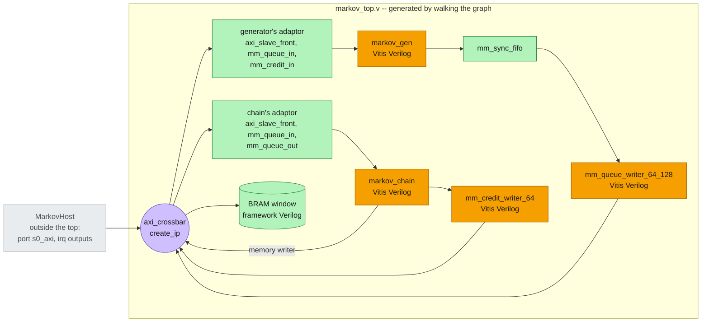
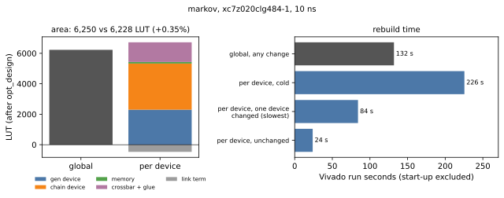

# Synthesis

Two steps of the [build flow](build.md) turn the system into Verilog. **csynth** runs Vitis HLS on the
four tops [Code generation](codegen.md) wrote. **system_rtl** generates the crossbar IP and walks the
pysim graph to the Verilog top that wires everything together. Fig. 2 is the same graph as
[Fig. 1](codegen.md), now with what each object becomes in RTL:



*Fig. 2 -- what each object becomes in RTL. Orange: csynth's Verilog for the four tops, by Vitis HLS.
Purple: AMD's crossbar IP, by Vivado's `create_ip`. Green: the framework's hand-written Verilog
(`waveflow/build/rtl/`) -- the adaptors' leaves, the memory's window, the FIFO. The box is
`markov_top.v`, generated. Grey: the host is not hardware; what it is bound to becomes a port of the
top, and it is driven by a testbench in [XSI testbench](xsi.md).*

```bash
python -m examples.markov.markov_build --through csynth       # the four tops' Verilog
python -m examples.markov.markov_build --through system_rtl   # and the crossbar IP and the top
```

## csynth: the four tops {#csynth}

The [csynth](../../guide/build/xsi_system.md#csynth) step has one inner step per HLS top the system's
cut instantiates. The set is derived from the system (`spec.modules`, below), not listed: the two
kernels, and the two writers the routed credit link brings with them. Each top is its own Vitis project,
the unit of rebuilding, since Vitis has no incremental csynth. Its Verilog lands in
`<top>_proj/solution1/syn/verilog/`.

A top is **fresh while its source stamp matches**. After csynth, `rtl_sources.json` beside the project
records a digest of every source it was built from -- `gen/<top>.cpp`, every header in `include/`,
everything in `src/`. A run compares those digests against the sources on disk. So the identical bytes
`codegen` rewrites every run re-synthesize nothing, and neither does a `git checkout` that restores
identical files. Change one top's `gen/<top>.cpp` and that top alone re-runs. Change a header or a
kernel body and **all four** re-run (about two minutes): the stamp covers the whole of `include/` and
`src/`, not just what each top includes.

Who may run Vitis is the `synth` parameter: `--synth build` (the default) synthesizes a stale or missing
top and stamps it; `--synth check` -- what the gates use -- fails on one instead, naming the top and the
source that changed, and never runs the toolchain. The timing each top closes at is on
[Code generation](codegen.md).

## system_rtl: the crossbar and the top {#system-rtl}

The [system_rtl](../../guide/build/xsi_system.md#system-rtl) step builds what csynth does not. It
starts from the system's cut:

```python
sysm = system()
spec = system_top_spec(sysm.xbar, [sysm.gen, sysm.chain, sysm.mem], top="markov_top",
                       xbar_name="xbar_markov_4x3")
```

`system_top_spec` ([`waveflow/build/system_top.py`](../../../waveflow/build/system_top.py)) walks the
pysim graph out from the crossbar. The list is **the cut**, what is built into the top: the two kernels
and the memory. What belongs to them comes along: each kernel's adaptor and views
([each kernel's memory-mapped device](system.md#step-4-each-kernels-memory-mapped-device)), and the
credit link's two writers ([the credit stream, routed](system.md#step-5-the-credit-stream-routed)).
Everything else -- the host -- stays outside, and what it was bound to becomes a port of the top. The
build does not need this call written out: `add_system_steps` takes the same cut by default (every
kernel whose device is a crossbar slave, then every memory on the crossbar). Writing it is for asking
about the top without building it.

**The crossbar IP.** `spec.xbar` is the crossbar's configuration -- four SI, three MI, at the ranges
`assign_address_ranges` set -- so the IP that AMD's `create_ip` generates decodes the same addresses
pysim did. It is cached by that configuration under `xsi_work/ip/`, so it is generated once.

**The top.** `render_system_top(spec)` emits `markov_top.v`:

| in the pysim graph | in `markov_top.v` |
|---|---|
| `host.m` on crossbar master 0 | the top's AXI4 slave port `s0_axi` |
| the writers' and the chain's masters (1, 2, 3) | crossbar SI slots on internal wires `si1_axi` .. `si3_axi` |
| each device's port, the memory | MI slots: two adaptors (`render_adaptor_slot`) and a BRAM window |
| each `StreamIF` | stream nets named after it (`gen_k_qcmd`, `u_fwd`, `chain_k_qu`, ...) |
| `u_fwd`, 32 deep, between two kernels | an `mm_sync_fifo` |
| the two writers | their csynth'd tops, each with its `target` (the peer view's word address) |
| the `IrqIF`s to the host | outputs `irq_gen_qcmd`, `irq_chain_qresp` |

Each kernel's pins come from the same `TopSpec` its csynth top was rendered from, and the tie-offs
(unused `s_axi_control` inputs low, ID widths, unframed ports' `TLAST`) are the framework's rules. The
spec can be asked before it is rendered -- `spec.si`, `spec.mi`, `spec.nets`, `spec.irqs`,
`spec.modules`.

**What it leaves.** `xsi_work/markov/markov_top.v`, and `rtl.json`: every Verilog file the top compiles
-- the crossbar IP's simulation files, the framework leaves its instances use, each csynth'd module's
files, the top -- and the IP's include directories. That list is all [XSI testbench](xsi.md) needs of
this page.

## Resources: what the system costs {#resources}

`spec.instances()` lists the fifteen instances `markov_top.v` holds -- four kernels, ten hand-written
leaves, the crossbar -- each with the pysim object it realizes. Four more steps price them
([Systems](../../guide/resource/systems.md)):

```bash
python markov_build.py --through resource_report --platform <name>            # seconds
python markov_build.py --through system_synth --platform <name>               # ~2 min of Vivado
```

`kernel_resources` files each top's csynth attribution; `resource_report` prints the estimate, a row per
pysim object. After `system_synth` (xc7z020, 10 ns) the measured total sits beside it:

| row | LUT | FF | BRAM18 |
|---|---:|---:|---:|
| `chain` (`MarkovChain`) | 2,031 | 3,115 | 0 |
| `u` (`MmCreditStreamIF`: two writers and a FIFO) | 1,355 | 1,658 | 2 |
| `gen` (`MarkovGen`) | 1,193 | 1,298 | 0 |
| `xbar` (the crossbar) | 849 | 680 | 0 |
| `chain_mm`, `gen_mm` (the adaptors) | 719 | 395 | 0 |
| `mem` (`MemoryMod`: the BRAM window and its memory) | 132 | 39 | 2 |
| system integration | 2 | 2 | 0 |
| **total** | **6,281** | **7,187** | **4** |

The kernels are the cost, and each is about half what its csynth report estimated. The memory is one
RAMB36 -- since `bram_t2p` was recoded with one `always` block per port: the first synthesis found it
built from flip-flops, 8,769 LUT and 32,832 FF of a 18,593 / 40,130 total.

## Two routes to the board: global or per device {#routes}

On its way to a board the system is [packaged as IP, one per device](../../guide/build/ipi.md), and
that leaves a choice of how Vivado synthesizes it
([Toward the board](../../guide/flows/bitstream_ipi.md)). markov has four parts:

| part | holds | why there |
|---|---|---|
| generator device (`u_gen_sub`) | `MarkovGen`, its `qcmd` queue and `u_crd` credit counter, its AXI front, **the forward writer** | the forward writer carries the generator's data into the chain's queue: it is the generator's bus master |
| chain device (`u_chain_sub`) | `MarkovChain` (its memory writer included), its `qu` and `qresp` queues, its AXI front, **the credit writer** | the credit writer returns credit to the generator: it is the chain's bus master |
| memory (`u_mem_sub`) | the BRAM window and `bram_t2p` | one IP, its kernel port tied idle |
| crossbar (`u_xbar`) | `axi_crossbar` | AMD's IP, configured |

Each bus writer sits with the kernel it acts for, so every link between parts is AXI4 or an
interrupt. **Global** synthesizes the system top in one run and then runs `opt_design`. **Per
device** synthesizes each device and the memory out of context, then the crossbar and the glue
against black boxes, links the netlists, and runs `opt_design`
([per device](../../guide/resource/systems.md#per-device)). One step runs both, each cached by
content:

```bash
python -m examples.markov.markov_build --through sync_routes_figure   # minutes of Vivado cold
```



*Fig. 3 -- markov synthesized both ways, on xc7z020 at 10 ns (a stand-in: the board's xczu48dr
needs a Vivado license this machine lacks). Left: LUT after `opt_design`, the per-device parts
stacked, the link term below zero. Right: the Vivado seconds each rebuild costs, from the runs' own
timers, start-up excluded.*

**Area.** Synthesizing apart costs almost nothing:

| | LUT | FF | BRAM18 |
|---|---:|---:|---:|
| generator device, alone | 2,299 | 2,560 | 2 |
| chain device, alone | 3,028 | 3,934 | 0 |
| memory, alone | 103 | 39 | 2 |
| crossbar and glue, alone | 1,292 | 808 | 0 |
| link term | −472 | −242 | 0 |
| **per device, linked** | **6,250** | **7,099** | **4** |
| **global** | **6,228** | **7,091** | **4** |

The parts plus the measured link term are the linked total exactly. The link term is mostly the
crossbar's: 1,292 LUT alone against 849 in the global synthesis (the resources table above). Against global
synthesis, per device costs **22 LUT (+0.35%)** and 8 FF: what Vivado can no longer optimize across
a device's boundary. The memory's tie-off is inside its own module, so it prunes alone, and the
BRAM is the same.

**Time.** The two routes win on different rebuilds:

| rebuild | global | per device |
|---|---:|---:|
| cold | 132 s | 226 s |
| one device changed | 132 s | 56-84 s |
| nothing changed | none | 24 s (the link) |

Cold, per device pays one run per part, each with its own fixed overhead. After a change to one
device it re-synthesizes that device and re-links; global synthesizes everything again. So global
is the default for a bitstream, and per device is for a loop that changes one device at a time,
such as a design-space search. Packaging is per device either way.

These numbers are not typed in. `markov_routes` writes them to `results/routes.json` with the
figure, and `sync_routes_figure` copies both to `images/`. A test holds this page's tables to that
record, and another holds the record's area to a fresh run.
