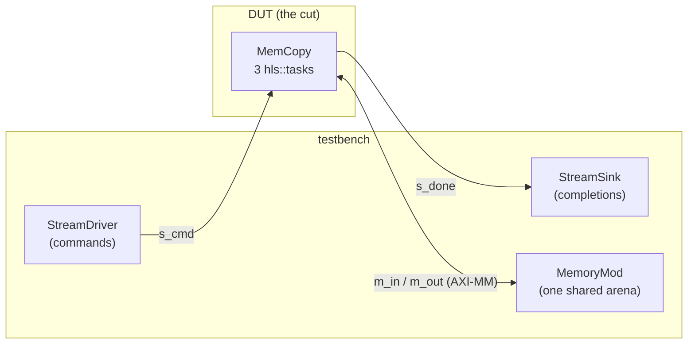

# The system

The [testbench](./testbench.md) page built the graph, `wire_mem_copy`: the copy kernel *and* the
participants around it, on one simulation. To take that graph to RTL, one more fact is needed —
**which part of it is the design** — and that fact is stated once, on a **system**.

## What a system is

A system is the graph plus the **cut**: the modules synthesized into the design under test (DUT). The
rest of the graph is the testbench. DUT and testbench are not kinds of module; they are roles the cut
assigns. For `mem_copy` the cut is the kernel alone:



The crossbar that models the two `m_axi` bundles' contention in pysim is *outside* the cut, so it is
part of the testbench. On the RTL side the kernel's two bundles therefore become ports of the top,
each facing the memory model.

## `mem_copy_system()`

The system is a short function in `examples/mem_copy/mem_copy_sim.py`. It builds the graph on one
simulation, names the DUT, and hands both to
[`HwSystem(sim, dut)`](../../guide/build/xsi_system.md#the-system) with the run's description:

```python
def mem_copy_system(jobs=..., mem_dwidth=64, n_cycles=3400, ...) -> HwSystem:
    sim = Simulation()
    parts = wire_mem_copy(sim, jobs=jobs, mem_dwidth=mem_dwidth, ...)   # the testbench page's graph
    parts.n_cycles = int(n_cycles)
    runner = MemCopySim.on(parts)                                       # its scenario and its golden
    dut = DutTop.of("mem_copy_dut", sim, comps=[parts.dut])             # the cut: the kernel alone
    sysm = HwSystem(sim, dut, n_cycles=int(n_cycles), inputs=runner.write_scenario,
                    check=lambda s: runner.check(),
                    fresh=lambda: mem_copy_system(jobs, mem_dwidth, n_cycles, ...))
    sysm.kernel, sysm.driver, sysm.done_sink, sysm.mem = parts.dut, parts.driver, ...  # for tests
    return sysm
```

What each argument gives the flow:

| argument | what it is | mem_copy's |
|---|---|---|
| `dut` | the root of what is synthesized; everything else on `sim` is the testbench | a `DutTop` holding the `MemCopy` kernel |
| `inputs` | `(root) -> None`, writes what the testbench plays | `MemCopySim.write_scenario`: `s_cmd`, `mem_in`, `golden` |
| `n_cycles` | the RTL run's bound, written to `vectors/run.json` beside the inputs' own params | 3400 |
| `check` | what `run()` returns, after pysim | the golden check, `MemCopySim.check` |
| `fresh` | an unrun copy, for a second pysim pass | the same call again |

The rest is derived: the testbench is every root on the simulation outside the DUT
(`participants()`: the driver, the sink, the memory); every participant with a bundle is anchored at
the run's root, so pysim records what the RTL records; `run()` writes the scenario, runs pysim and
returns `check`'s value.

So `mem_copy_system().run()` is the same pysim golden as `MemCopySim().run()`. The system adds no
behaviour; it adds the cut.

## What the system flow generates

`examples/mem_copy/mem_copy_system_build.py` hands the system to the framework's system steps:

```python
def system() -> HwSystem:
    return mem_copy_system(jobs=XSI_JOBS)                # the 16-job scenario

def build_dag(work_dir=WORK_DIR) -> BuildDag:
    dag = BuildDag()
    add_system_steps(dag, system(), work_dir=work_dir, top="mem_copy_system",
                     tcls={"mem_copy": Path("mem_copy.tcl")})
    return dag
```

From the system alone, the steps derive three things.

**The system top** (`mem_copy_system.v`). The csynth'd kernel is instantiated inside it, and every
connection that crosses the cut becomes a top port of its own kind:

- `s_cmd` and `s_done` become AXI-Stream ports, named for the interfaces they were on;
- the two `m_axi` bundles become AXI4 master groups, `m0_axi` and `m1_axi`.

Nothing in the top was written for `mem_copy`; it is a walk of the graph across the cut.

**The harness** (`mem_copy_system_tb_harness.h` and a three-line `main`). This is one C++ model per
testbench participant, each the participant's own declared twin (`bfm_model()`), bound to the top's
ports:

| pysim participant | XSI model | answers the top's port |
|---|---|---|
| `StreamDriver` | `AxisMaster` | the `s_cmd` stream |
| `StreamSink` | `AxisSlave` | the `s_done` stream |
| `MemoryMod` | `FlatMemory` + `AxiMmReadSlave` / `AxiMmWriteSlave` | `m0_axi` / `m1_axi` |

The memory expands to three objects: one arena, plus a slave per bundle serving it. In pysim the
crossbar was one interface; at RTL each bundle is a port group of its own. The models come from the
framework's BFM library ([The BFM models](../../guide/build/bfm.md)) and know nothing about
`mem_copy`. The `main` only constructs, runs and closes:

```cpp
int main() {
    mem_copy_system_tb::Harness h("mem_copy_system.wdb");
    h.run(wfbfm::run_param("n_cycles", 1000000));   // the scenario's bound, from vectors/run.json
    h.close();
    return 0;
}
```

**The scenario** (`scenario/vectors/`). This is `inputs`'s output — `s_cmd`, `mem_in`,
`golden` — plus `run.json`, which holds the cycle bound (3400) and the arena size the memory model
allocates. The pysim run and the RTL run each start from a fresh copy of it, so the two runs read
the same bytes.

There is no golden in the C++. The models record what crossed the cut: the sink its completions,
the memory its final arena. Python checks those recordings, on the [RTL simulation](./rtlsim.md)
page.

## Next

[RTL simulation](./rtlsim.md) — run the system flow end to end, compare the RTL's recordings with
pysim's, and check the golden at 2908 cycles.
