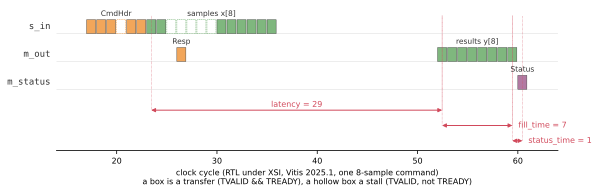

# Timing

pysim's timing for the kernel comes from two **declared timed phases** -- spans between events at its
own ports, with the features their durations depend on
([Timed phases](../../guide/timing_model/timed_phases.md)):

```python
self.samp_phase = TimedPhase(
    "samples", spans={"latency": (self.s_in.first, self.m_out.first),
                      "fill_time": (self.m_out.first, self.m_out.last)},
    features=("nwords",), calib_dir=HERE / "calib")
self.status_phase = TimedPhase(
    "status", spans={"status_time": (self.m_out.last, self.m_status.first)}, calib_dir=HERE / "calib")
```

- **samples** is pipelined: `latency` from the first sample word in to the first result word out, then
  `fill_time` over the results -- the loop that reads a word, computes, writes a word.
- **status** is sequential: `status_time` from the last result word to the status's first word.

The `Resp` header is written before the samples phase begins, so it is in neither span: `latency` runs
from the first *sample* in to the first *result* out.

Every event is a handshake at a port, so every span can be measured at RTL.

## Calibrating them in the harness

The kernel names its calibration scenario and what to hold out of the fit:

```python
calib_holdout: ClassVar[dict] = {"nwords": CALIB_HOLDOUT}     # (48, 128): interior lengths test the fit

def workload(self, kind="test"):
    cmds = {"test": default_cmds, "calib": calib_cmds}[kind]()  # calib: nine lengths, 8 to 200
    return {"s_in": stimulus(cmds)}
```

`add_calib_steps` adds the calibration as a second, traced system sharing `codegen` and `csynth`, and
`calib_phases` fits it ([Fitting the model](../../guide/timing_model/fit.md)): pysim pairs the events
and supplies the features, the RTL trace supplies the times. Measured (Vitis 2025.1):

| span | fit | residual |
|---|---|---|
| `latency` | 29 cycles | 0 |
| `fill_time` | `nwords - 1` cycles | 0 |
| `status_time` | 1 cycle | 0 |

The held-out lengths are predicted exactly too.

## One command at RTL



One command of the calibration workload (its first: 8 samples) alone in the kernel's harness, from
the traced RTL run: a box is a handshake (TVALID && TREADY), a hollow box a cycle the sender waited
(TVALID without TREADY). The spans are drawn between the beats that bound them, and they are the fit's:
`latency` 29, `fill_time` 7 (`nwords - 1`), `status_time` 1. The `CmdHdr` and the `Resp` are in no span.

`latency` starts at the first *sample's* handshake, not when the kernel starts computing. The driver
sends the samples straight after the header, so `s_in` takes two of them and then stalls for five
cycles while the kernel writes the `Resp` and enters its loop. Those five cycles are inside the 29;
the pipeline's own latency is 24. On a bus, where the samples arrive later, `latency` is 24
([One command on the bus](../stream_kernel_mm/composition.md#one-command-on-the-bus)).

The figure comes from its own traced system (`fig_`, the kernel's harness on that one command). The
waveform is build output, so re-rendering it needs Vivado:

```bash
python -m examples.stream_kernel.stream_kernel_build --through sync_docs_figures
```

## Filed under the kernel's identity

The fit is one record in [`calib/`](../../../examples/stream_kernel/calib), filed under the kernel's
**identity** -- a digest of its structure, free of what its ports are bound to -- with the phases it was
fitted to. Wherever the kernel sits (its harness here, or a memory-mapped device), its phases load the
record its identity finds. A repeat of the calibration finds the record and runs no simulation; a kernel
whose phases changed finds none, and is calibrated again.

The same kernel on a bus, its timing composed from this record, is
[The polynomial on a bus](../stream_kernel_mm/index.md).
