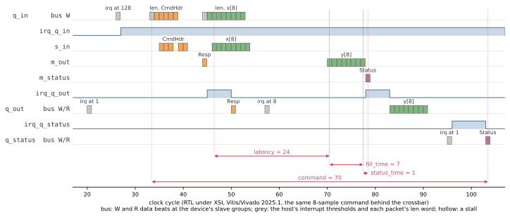

# Composition

The kernel was calibrated alone, in its stream harness ([Timing](../stream_kernel/timing.md)). This page
uses that record: pysim's timing of the bus system is **composed** from parts calibrated separately, with
nothing fitted to the system, and the system's RTL is the check
([Composed, and checked once](../../guide/systems/calibration.md#composed-and-checked-once)). The
device is checked twice: on the crossbar, and alone in its own harness.

## The device's own harness

```python
sysm = mm_system(direct=True)
```

`direct=True` is the **device's own harness**: the device built with its three views behind **one
front** (`one_front=True`), and the host's bus master bound straight to that front's slave group by a
direct link -- no crossbar. What it measures is the device's timing alone.

- **The link is wires.** At RTL it is `assign`s in the system top, so its latencies are zero
  (`DIRECT_LATENCY_INIT, DIRECT_LATENCY_TRAVEL = 0.0, 0.0`): a wire has no registers, and the front's own
  are in the adaptor's model. That is the physics of the link, not a fit.
- **The top has no crossbar.** `test_the_device_harness_runs_without_a_crossbar` checks pysim bit-exact
  against the golden, then renders the system top: a direct-link configuration, one MI slot (the
  adaptor), and no `axi_crossbar` in the Verilog.
- **Its own steps**, prefixed `dev_`, sharing `codegen` and `csynth` with the others
  ([On the build DAG](system.md#on-the-build-dag)):

```bash
python -m examples.stream_kernel.stream_kernel_build --through dev_compare
```

Both systems are the same `mm_system`, the same host and the same kernel; only the wiring between the
host and the views differs ([One adaptor, or one per view](../../guide/interface/axi_mm/slave.md#one-adaptor-or-one-per-view)).

## The composition check

Composed from the kernel's calibrated record, the queue views' models and the crossbar's (or the direct
link's), with nothing fitted here:

| system | composed from | pysim | RTL (Vitis/Vivado 2025.1) | |
|---|---|---|---|---|
| behind the crossbar (`mm_`) | the kernel's record, the queue views, the crossbar | 392 cycles | 385 cycles | +1.8% |
| the device alone, host on a direct link (`dev_`) | the kernel's record, the views, the one front | 383 cycles | 370 cycles | +3.5% |

Both are within the 5% gate, and each RTL count is pinned exactly: `test_composition_holds_without_fitting`
and `test_device_composition_holds_without_fitting` in
[`test_stream_kernel_mm.py`](../../../tests/examples/test_stream_kernel_mm.py) assert the RTL's cycles
(385 and 370) and pysim's within 5% of them.

**When a composition misses, the miss names what is not yet modeled.** The first composition on the
crossbar (with an earlier version of the protocol, when the RTL took 392 cycles) gave 466 in pysim, 19%
slow. Tracing the kernel's ports at RTL against pysim's log showed why: at RTL the first command's
results begin while its samples are still entering the kernel; in pysim they began after the last
sample, because the queue in delivered a packet only when the bus burst's last word landed. The fix was a
**cut-through** in the queue's model -- each packet begun as its first word lands -- not a number fitted to
this system ([the record](../../../plans/unit_harness.md), Stage 2b).

## One command on the bus



This is the command from the [stream example's figure](../stream_kernel/timing.md#one-command-at-rtl)
(8 samples), alone, behind the crossbar, from a traced RTL run (`fig_mm_`, `mm_system` on that one
command). The bus lanes are the W and R data beats at each view's slave group. The kernel's lanes are
the streams between the views and the kernel. Reading down the figure:

1. The host sets the interrupt thresholds (the grey beats).
2. It writes the header and then the samples into `q_in`, two bursts, each headed by its `len` word.
3. The kernel answers on its streams.
4. The host reads the `Resp`, then the results, then the status, each after its view's interrupt rises.

The kernel's spans come from its own ports, as in the harness:

- `fill_time` (7) and `status_time` (1) are the stream example's.
- **`latency` is 24, not the record's 29.** In the harness the samples come straight after the header,
  and two of them wait five cycles in `s_in` while the kernel writes the `Resp`. Here the samples are a
  second bus burst and reach `s_in` six cycles after the header, when the kernel's loop is already
  waiting. Nothing waits, and the span is the pipeline's own 24.

So the record overstates `latency` by 5 cycles whenever the samples arrive after the kernel is ready.
On this one command pysim gives 96 cycles against the RTL's 90 (+6.7%), and those 5 cycles are most
of the miss. They are probably also part of the +1.8% and +3.5% above. The fix belongs in the
kernel's model, not in the bus: `latency` should start when the kernel can take the first sample, not
at the sample's handshake.

The command takes 70 cycles, from the header's first bus write to the status read. The kernel's spans
cover 32 of them (24 + 7 + 1). The 13 before are the two write bursts reaching `s_in`. The 25 after
are the host's reads: the results after `irq_q_out`, then the status. The host arms the status
queue's interrupt only once it has read the results.

## What this practice is

A unit verified and calibrated alone, then composed: the kernel in its stream harness, the device in
its own, the system on the crossbar -- each step checked against its RTL, and nothing fitted above the
unit it belongs to. For the practice in general -- several units, hostile stand-ins, incremental
rebuilds -- see [Composing a parent](../../guide/flows/units_composing.md);
for a system of several calibrated units, [Two kernels on a bus](../markov/index.md), whose composition
lands at -0.9% ([Composed, and checked once](../../guide/systems/calibration.md#composed-and-checked-once)).
