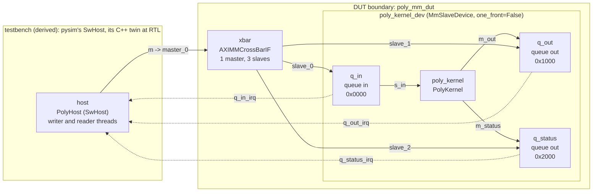

# The system

`mm_system(cmds, direct=False)` in
[`stream_kernel_mm.py`](../../../examples/stream_kernel/stream_kernel_mm.py) builds the whole system the
[`HwSystem(sim, dut)`](../../guide/systems/rtl.md#the-system) way: every module on one simulation, wired,
and then the DUT named. The DUT is the device and the crossbar; the host is the testbench, derived.

## The whole system



The host's one bus master, `m`, is the crossbar's one master; each view of the [device](device.md) is a
crossbar slave at its address. The dotted arrows are the `IrqIF` lines, one per view, from the view's
interrupt source to the host. Everything inside the boundary is RTL in the XSI run; the host is the only
part outside it.

## The modules

```python
from waveflow.hw.clock import Clock
from waveflow.hw.mm_device import build_mm_device         # the framework's
from waveflow.simulation.simulation import Simulation
from examples.stream_kernel.stream_kernel import PolyKernel  # the example's kernel
from examples.stream_kernel.stream_kernel_mm import PolyHost # the example's host

sim = Simulation()
clk = Clock(freq=100e6)
kernel = PolyKernel(name=PolyKernel.cpp_kernel_name, sim=sim, clk=clk)
host = PolyHost(name="host", sim=sim, cmds=cmds, clk=clk)
device = build_mm_device(kernel, sim=sim, clk=clk, mem_dwidth=W, one_front=direct)
```

The kernel and its [device](device.md), and the host ([The host](host.md)): a `SwHost` with one bus
master, `m`, and an interrupt input per view it waits on.

## The crossbar and the address map

```python
slaves, ranges = device.ranges(MM_BASE)
xbar = AXIMMCrossBarIF(name="xbar", sim=sim, clk=clk, nports_master=1,
                       nports_slave=len(slaves), bitwidth=W, latency_init=4.0, latency_travel=2.0)
xbar.bind("master_0", host.m)
for k, ep in enumerate(slaves):
    xbar.bind(f"slave_{k}", ep)
assign_address_ranges(slaves, ranges)
```

- **One master, three slaves**: the host's bus master, and one crossbar slot per view (the device is
  built with one bus port per view). `device.ranges(MM_BASE)` gives each slave port and its range.
- **The latencies are the crossbar's measured model**, not fitted to this system: `latency_init = 4`,
  `latency_travel = 2`, and on the host's master `max_outstanding = 1` and `issue_cycles = 2` -- what
  the C++ host's bus master does ([Matching pysim to it](../../guide/interface/axi_mm/crossbar.md#matching-pysim-to-it)).
- **The address map is written once.** `assign_address_ranges` places each slave; the RTL crossbar is
  generated from the same pysim crossbar, and the C++ host's endpoints are generated at the same
  addresses ([The address map](../../guide/interface/axi_mm/slave.md#the-address-map-a-layout-per-type-a-base-per-instance)).

## The host's endpoints and the interrupt lines

```python
mm = BoundMemSlaveAdaptor(device.layout.at(MM_BASE), host.m, poll_cycles=host.poll_cycles)
for name in HOST_ENDPOINTS:                       # ("q_in", "q_out", "q_status")
    line = IrqIF(name=f"{name}_irq", sim=sim)
    line.bind("source", device.views[name].m_irq)
    line.bind("sink", host.irq[name])
host.q_in = mm.stream_master("q_in", irq=host.irq["q_in"])
host.q_out = mm.stream_slave("q_out", irq=host.irq["q_out"])
host.q_status = mm.stream_slave("q_status", irq=host.irq["q_status"])
```

- `BoundMemSlaveAdaptor` takes the device's layout placed at its base and the host's bus master, and
  hands out each view **by name** as an ordinary stream endpoint -- a `StreamIFMaster` for the queue in,
  an unframed `StreamIFSlave` for each queue out. The host writes no address
  ([Reaching the views from a bus master](../../guide/interface/axi_mm/slave.md#reaching-the-views-from-a-bus-master)).
- **An `IrqIF` per view** joins the view's interrupt source to the host's sink, and each endpoint is
  given its line (`irq=`), so it sleeps on the interrupt rather than reading the queue's count
  ([Interrupts](../../guide/interface/axi_mm/slave.md#interrupts)). `poll_cycles` would pace an endpoint
  that polls; none does.

## The DUT, and the system

```python
dut = DutTop.of("poly_mm_dut", sim, comps=[device], ifs=[xbar])
sysm = HwSystem(sim, dut, run_until=host.done, check=check,
                fresh=lambda: mm_system(cmds, direct=direct))
```

The DUT is the device and the crossbar. `HwSystem` derives the testbench -- everything else, here only
the host -- and checks that each part has an RTL twin: the host's is its C++ program. `run_until` ends
the run when the host's reader is done; `check` returns the host's headers, results and statuses with the
golden's (`expected(cmds)`); `fresh` builds a new copy for each run.
`test_it_is_built_the_d12_way` ([`test_stream_kernel_mm.py`](../../../tests/examples/test_stream_kernel_mm.py))
pins the shape: the participants are `["host"]`, the DUT's one child an `MmSlaveDevice`, and the cut
`["poly_kernel"]` -- the device's kernel ([The cut is a set](../../guide/build/xsi_system.md#the-cut)).

## On the build DAG

[`stream_kernel_build.py`](../../../examples/stream_kernel/stream_kernel_build.py) adds the bus system
to the stream example's DAG with a prefix:

```python
add_system_steps(dag, mm_system(), work_dir=work_dir, top=MM_TOP, prefix="mm_")
add_system_steps(dag, mm_system(direct=True), work_dir=work_dir, top=DEV_TOP, prefix="dev_")
```

The steps are the framework's ([The system flow](../../guide/systems/rtl.md#the-system-flow)), named with
the prefix and sharing the stream example's `codegen` and the kernel's `csynth` -- the kernel is
synthesized once for all three systems:

| step | what it does here |
|---|---|
| [`mm_system_rtl`](../../guide/build/xsi_system.md#system-rtl) | the crossbar IP, then the Verilog top: the crossbar and the device's sub-top |
| [`mm_scenario`](../../guide/build/xsi_system.md#scenario) | the host's scenario file, one burst per command |
| [`mm_pysim`](../../guide/build/xsi_system.md#pysim) | the system in pysim from that file |
| [`mm_system_xsi`](../../guide/build/xsi_system.md#system-xsi) | the RTL under XSI, the host's C++ twin on the bus |
| [`mm_compare`](../../guide/build/xsi_system.md#compare) | the host's endpoint traces, RTL against pysim |

```bash
python -m examples.stream_kernel.stream_kernel_build --through mm_compare
```

At RTL (Vitis/Vivado 2025.1) the run takes **385 cycles** for the four commands of `good_cmds()`, and
the host reports zero polls.

Next, [The host](host.md): the program on the other side of the bus.
