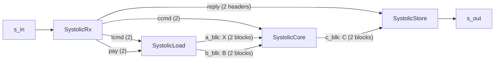

# Architecture

This page follows one job through the unit, at the centre configuration of the
[main page](index.md) (`Mmax 8, Kmax 8, Nmax 32, R 4, C 8, L 4`, 64-bit words) wherever a number is
needed. Every statement about the hardware cites the task body that does it, in
[`waveflow/build/`](../../../../waveflow/build/). The measured numbers are from one RTL run of the unit
in its own harness, fed straight from streams (Vitis HLS / Vivado xsim **2025.1**,
`xczu48dr-ffvg1517-2-e`, 4 ns); [where they are measured](#the-schedule-measured) is at the end.

## Four tasks, one job per firing

Each task is a free-running `hls::task`; each firing handles one request:

| Task | Body | One firing |
|---|---|---|
| receiver | [`systolic_rx_task.h`](../../../../waveflow/build/systolic_rx_task.h) | reads the request header, validates it, writes the job to the loader and the core and the reply header to the store, then forwards the payload word by word (`FWD`, II 1) -- or drains it, for a refused request |
| loader | [`systolic_load_task.h`](../../../../waveflow/build/systolic_load_task.h) | takes a write lock on an `X` block and unpacks `A` into it, then the same for `B` |
| core | [`systolic_core_task.h`](../../../../waveflow/build/systolic_core_task.h) | copies `X` and `B` into its own banks, releases both blocks, computes every tile of `C` into a `C` block |
| store | [`systolic_store_task.h`](../../../../waveflow/build/systolic_store_task.h) | writes the reply header, then takes a read lock on the `C` block and packs it into reply words |

The numbers in brackets are channel depths. The three block channels are
`hls::stream_of_blocks` ping-pong buffers of two blocks each (`sob_depth`). The `reply` channel holds
two reply headers: the store keeps a header for its whole firing (the header, then `C`), and a
shallower channel stops the receiver on the next request's header -- that was the unit's
serialization until 2026-10 ([Timing](timing.md#the-fix)).

## Where the matrices are held

| Storage | Holds | Shape and banking | Implemented as (2025.1 csynth) |
|---|---|---|---|
| `a_blk` | `X` (`A`, or `Aᵀ` for `MUL_AH`), row-major lane groups | `Mmax·Kmax/L` groups of `L` complex values, ×2 blocks | block RAM, 6 BRAM18K |
| `b_blk` | `B`, row-major lane groups | `Kmax·Nmax/L` groups, ×2 blocks | block RAM, 6 BRAM18K |
| `c_blk` | `C`, row-major lane groups | `Mmax·Nmax/L` groups, ×2 blocks | block RAM, 6 BRAM18K |
| core `xs_r`, `xs_i` | `X` as the array reads it | `[Mmax][⌈Kmax/L⌉][L]`, partitioned on rows and lanes: a bank per row of `X`, a register per lane | LUTRAM / registers |
| core `br`, `bi` | `B` as the array reads it | `[Kmax][Nmax/C][C]`, partitioned on the last dimension: **a bank per array column** | LUTRAM |
| core accumulators | one tile of `C` | `acc_re`, `acc_im` `[R][C]` at `acc_t` width, fully partitioned | registers |
| core shift registers | the values moving through the array | `a_r`, `a_i` `[R][C]` (`a_t`), `b_r`, `b_i` `[R][C]` (`ba_t`) | registers |

The lane group is the unit of transfer between tasks: `L` complex values, the real part of lane `l`
in bits `[2W·l, 2W·l + W)` and the imaginary part above it
([Linear-Algebra Conventions](../linalg_common.md#lane-groups-and-message-words)). Every block is a
whole matrix at its maximum size, so a job of any size up to the maxima moves each operand once.

**The `X` store and its pre-skew.** Row `i` of `X` is read by row `i` of the array one value per step,
so each row of `X` is its own bank ([`systolic_core_task.h:104-145`](../../../../waveflow/build/systolic_core_task.h)).
Value `(i, kk)` sits at index `off_i + kk` of row `i`, slot `idx / L`, lane `idx % L`, with
`off_i = (i·k) mod L`. When `L` divides `k`, `off_i = 0`. When `k < L` (a row shorter than a group), a
group holds `L/k` whole rows; the core writes the whole group to every row it holds and each row reads
its own values from lane `off_i` on. That is why `k` must be a multiple of `L` or divide it.

**The `B` store.** Value `(kk, ct·C + j)` of `B` goes to `br[kk][ct][j]`: bank `j` feeds column `j`
of the array, so all `C` columns read their entry of row `kk` in the same cycle
([`systolic_core_task.h:150-181`](../../../../waveflow/build/systolic_core_task.h)).

## Load

The loader unpacks message words into lane groups through the generated array utilities
([`wf_matrix_io.h`](../../../../waveflow/build/wf_matrix_io.h), `wf_load_matrix`), one word per cycle
(`WORDS`, II 1). With 16-bit lanes a 64-bit word holds two complex values, so `A` (64 values) is 32
words and `B` (256 values) 128. For `MUL_AH`, `wf_load_matrix_transposed` writes `Aᵀ` into the block
one value per cycle at best (a read-modify-write of a lane group, `ELEMS`, II 2 at this
configuration).

The core then copies the blocks into its banks, a lane group per cycle: `X` in `m·k/L` cycles
(`LOAD_A`) and `B` in `k·n/L` (`LOAD_B`), and **releases each block as soon as it is copied**. From
then on the loader can fill the next job's blocks while the core computes.

## Tiling: one array tile at a time

`C` (`m × n`) is covered in `(m/R) · (n/C)` tiles of `R × C`, row tiles outer (`TILE_R`), column tiles
inner (`TILE_C`) ([`systolic_core_task.h:183-281`](../../../../waveflow/build/systolic_core_task.h)).
For each tile:

1. **Clear** the accumulators and the shift registers.
2. **Sweep** `k + R + C − 2` steps (`SWEEP`, II 1). The array is output-stationary: element `(i, j)`
   holds `C[i][j]` of the tile and accumulates it over `kk`. At step `t`, the left column (`j = 0`)
   takes `X[i][t − i]` from its row bank and the top row (`i = 0`) takes `B[t − j][j]` from its column
   bank, both zero outside `0 ≤ kk < k`; every other element takes its left neighbour's `X` value and
   its upper neighbour's `B` value from the step before. So element `(i, j)` meets `X[i][kk]` and
   `B[kk][j]` at step `t = i + j + kk` -- the usual skew, with no valid flags. The loops run in reverse
   order so each element reads its neighbours' values from the previous step.
3. **Round and write** the tile: `R·C/L` lane groups (`OUT_C`, II 1), each `L` accumulators rounded and
   saturated once to `c_t`; for `MUL_AH` the exact imaginary sum is negated first.

At the centre, a job has 8 tiles (2 row tiles × 4 column tiles); a sweep is `8 + 4 + 8 − 2 = 18` steps
and a tile writes `4·8/4 = 8` groups.

The products and sums are exact (`p_t`, `acc_t`), so the order of the sweep does not change the
result, and `C` is rounded once. `MUL_AH` negates `B`'s imaginary part as it enters the array, in
`ba_t`, one bit wider ([main page](index.md#what-it-computes)).

**This is one level of tiling** -- from on-chip storage into the array. The unit holds whole matrices,
so off-chip traffic is minimal (each element moves once), but only up to `Mmax`, `Kmax`, `Nmax`.
Matrices larger than that need a level above: an output-stationary outer loop that holds a `C` tile on
chip at accumulator width while panels of `A` and `B` stream past it, with traffic about `2·MNK/b` for
a `b × b` tile. That level, and the addressed operands it needs, are not built
(`plans/systolic_characterization.md`, Stage 6).

## Store

The store reads the reply header the receiver prepared and writes it at once; for a served request it
then takes a read lock on the `C` block and packs it into reply words, one word per cycle
(`wf_store_matrix`, II 1). A refused request's reply is the header alone. The store holds its firing
until `C` is out, which is why the `reply` channel must hold the next header.

## The schedule, measured

Four back-to-back `8×8×32` `MUL` jobs, the unit fed straight from streams in its own harness. Cycles are
those of the run's trace (the VCD the harness's XSI run writes); the events are the block channels'
release handshakes and the core's writes into the `C` block, all top-level wires of the generated top
([Timing](timing.md) lists them).

| Job 0 | Cycle | Span |
|---|---|---|
| loader releases the `X` block, then the `B` block | 200, 201 | the payload took 163 words |
| core takes the command | 201 | |
| core has copied `X`, releases the block | 223 | 22 (`m·k/L` = 16 groups) |
| core has copied `B`, releases the block | 291 | 68 (`k·n/L` = 64 groups) |
| core writes its tiles' outputs | 321, 357, 393, 429, 467, 503, 539, 575 | **36 a tile**, 38 across a row-tile boundary |
| core releases the `C` block | 589 | |
| core takes job 1's command | 591 | **390** after job 0's |

Job 1's `X` and `B` blocks were released by the loader at 380 and 381, while the core was still on
job 0's tiles; job 0's reply left the unit while the core worked on job 1. **The steady interval is
390 cycles a job, set by the core alone**: 22 (copy `X`) + 68 (copy `B`) + 30 (the first tile, to
its outputs) + 254 (seven more tiles) + 16 (the last outputs, the release, the next command). Its
parts say where the next design can gain:

- **A tile costs 36 cycles for an 18-step sweep.** The other half is the sweep's pipeline fill and drain
  and the 8 output groups, which do not overlap the next tile's sweep.
- **The copies are serial with the compute.** Copying `X` and `B` into the core's banks (90 cycles) runs
  inside the core's firing, before its first tile.
- **The input and output are not the limit.** 163 words in and 131 out per job, at a word a cycle,
  overlap the core's 390.
