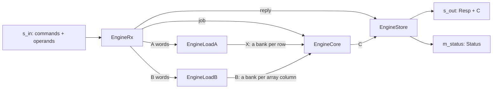
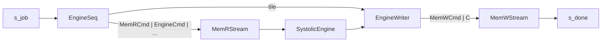

# Systolic engine

`SystolicEngine` and `SystolicEngineMem` (`waveflow/linalg/systolic_engine.py`,
`systolic_engine_mem.py`) are the redesign of the [systolic unit](index.md), from what its
[architecture](architecture.md) and [timing](timing.md) showed. The arithmetic is the same -- complex
fixed point, exact sums, one rounding, bit-exact with `waveflow.linalg.matmul.matmul` -- and so are the
traits and formats. What changes is how the operands reach the array and how the array runs.

All numbers here: Vitis HLS / Vivado xsim **2025.1**, `xczu48dr-ffvg1517-2-e`, 4 ns, the centre
configuration (`Mmax 8, Kmax 8, Nmax 32, Pmax 4, R 4, C 8, L 4`, 12-bit operands, 64-bit words).

## What changed, and what it bought

| | `SystolicUnit` | `SystolicEngine` |
|---|---|---|
| operands into the array | copied from the block buffers into the core's banks (90 cycles a job) | loaded straight into **banked** buffers the array reads in place: no copy |
| a tile | sweep, then drain, then the next tile: 36 cycles | **streaming**: each element latches its sum on a `first` flag and starts the next tile at once: `P = max(kp, R·C/L, L)` = 8 cycles |
| `K` larger than the buffers | not possible | `npanels` k-panels accumulated exactly on chip, rounded once |
| reuse of `A` | `nb` (core only) | `keep_a`: one `A` on the wire for `nb` outputs |
| protocol | status in the reply header, errors drained | a `Resp` per output, a `Status` per command on its own stream, errors fatal |
| `8×8×32` back to back, stream-fed | 390 cycles a job | **175** (input-bound: 162 words a job) |
| unit resources (csynth) | 136 DSP, 20.5k LUT, 18 BRAM18K | 154 DSP, 37.0k LUT, 26 BRAM18K |

## The engine

**The command** (`EngineCmd`, one burst on `s_in`): `tx_id`, `op` (`MUL` or `MUL_AH`), `m`, `kp`, `n`,
`npanels`, `nb`, `keep_a`. The operands follow, one burst each, in the order the core takes them: with
`keep_a`, `A` then the `nb` matrices `B`; otherwise, per output and per panel, `A` then `B`. `A` is
`m × kp` (`kp × m` for `MUL_AH`) and `B` is `kp × n`, row-major memory elements. Each output is
`C = q(Σ_p A_p·B_p)`, rounded once. Rules: `m` a multiple of `R`, `n` of `C`, `1 ≤ kp ≤ Kmax`,
`npanels ≤ Pmax`, `keep_a` only with one panel; otherwise `BAD_OP` / `BAD_DIMS`, and the receiver stops
taking input (fatal, until a reset).

**Two loaders.** The receiver sends `A` words to one loader and `B` words to the other, so each fills
its next block while the core sweeps the current one. One loader writing both in turn would serialize:
the RTL ping-pong lets a writer *commit* a block only after the reader frees the earlier one, and the
core frees `A` and `B` together. The `A` channel holds a whole `A`, so the receiver moves straight on to
`B` while the `A` loader -- a value a cycle -- drains it.

**The banked buffers.** `X` is `[Mmax][Kmax]`, a bank per row; `B` is `[Kmax][Nmax/C][C/LW][LW]`, a
bank per array column, laid out so a word's `LW` values land in lanes the compiler can tell apart
(`LW` values per word, a word a cycle). They are declared on the channels with
`StreamOfBlocksIF.bank(shape, partition)`, which the generated top turns into a partitioned
`stream_of_blocks`: Vitis builds a ping-pong per bank, and a reader takes one value from every bank a
cycle ([witness](../../../../plans/witness/systolic_stream/README.md)).

**The streaming array.** One pipelined loop runs every tile of a panel: row `i` takes tile `q`'s value
`kk` at step `q·P + kk + i`, column `j` at `q·P + kk + j`, zero for `kk ≥ kp`; a `first` flag and the
tile's index ride with the row's values. On the flag an element latches its sum into a shadow and
starts the next tile -- from zero on the first panel, from its partial sum on the others (an
accumulator store in LUTRAM). Shadows drain while the next tile runs, group `(i, cg)` at step
`(q+1)·P + L + n` in diagonal order -- into the store, or on the last panel rounded once into `C`.
Every loop of the engine is at II 1; the core is one copy of the array (137 DSP).

## Behind memory: the outer loop

`SystolicEngineMem` takes one `EngineJobDesc` per product (`tx_id`, `op`, `M`, `K`, `N`, and the base
word addresses of `A`, `B` and `C`) and answers each with an `EngineDone`. The loop is output-stationary:
`C` is covered in `Mmax × Nmax` tiles, each one engine command of `npanels = K / Kmax` panels. The
sequencer sends the memory reader `MemRCmd(A(i,0), fwd 1) | EngineCmd | MemRCmd(B(0,j)) |
MemRCmd(A(i,1)) | ...` -- the reader relays the command ahead of the first operand -- and the writer
turns each tile's `Resp | C` into `MemWCmd(C(i,j)) | C`, echoing the job's `EngineDone` on its last
tile. The in-band reader and writer of one generated top must fire equally often (their `m_axi` pointer
FIFOs couple them), so the writer adds `2·npanels − 1` empty writes per tile.

**Memory is block-major** (`block_major`): `A`'s panel `(i, p)` at `a_base + (i·P + p)·wa`, `B`'s
`(p, j)` at `b_base + (p·NT + j)·wb`, `C`'s tile `(i, j)` at `c_base + (i·NT + j)·wc`, each one burst.
`M`, `K`, `N` must be multiples of `Mmax`, `Kmax`, `Nmax` and `K ≤ Pmax·Kmax`; pad with zeros.

## Measured

| What | Result |
|---|---|
| engine, six commands (panels, `keep_a`, `Aᴴ` with panels, `kp = 1`) | bit-exact at RTL, pysim equal |
| engine, 4 × `8×8×32` back to back, stream-fed | **175 cycles a job**: 162 words in, the receiver's 13 cycles of command handling |
| wrapper: a 2×2-tile 2-panel job, an `Aᴴ` job of 4 panels, a single tile | `C` in memory exact at RTL |
| wrapper: `32×32×64` (8 tiles × 4 panels) | exact at RTL, done at **cycle 6,655** against an input floor of about 5,136 |
| engine resources | 154 DSP, 37.0k LUT, 25.6k FF, 26 BRAM18K, est. 3.05 ns |
| wrapper resources | 156 DSP, 43.2k LUT, 31.0k FF, 30 BRAM18K, est. 3.35 ns |

Gates: `tests/linalg/test_systolic_engine.py` (`-m xsi` for the RTL ones).

## Limits

- **Not calibrated.** The core's pysim time is one phase per panel (`b_blk.first -> b_blk.last`,
  `20 + tiles·P`) seeded from the prototype; the calibration is the last step of the plan, once the
  design settles.
- **`R ≤ L`.** The drain schedule needs distinct diagonals; `R > L` is refused at construction.
- **Wrapper tiles are the maxima.** Every tile is `Mmax × Nmax × Kmax` per panel; other shapes pad.
- **The wrapper is not yet input-bound** (77% of the floor at `32×32×64`): eight read commands a tile,
  each a separate burst through the memory reader.
- **LUTs.** The array costs about 1.8× `SystolicUnit`'s LUTs for 2.2× its throughput; the per-element
  selects are the next place to look.
- **Ordered, not addressed.** Operands are reused in order (`keep_a`), not by address. Addressed
  regions would need hand-written T2P BRAMs shared between tasks (`T2pBram`, `LockedT2pMemIF`).
