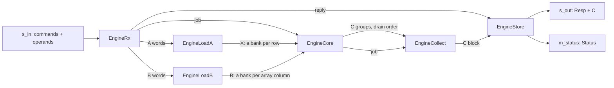

# Systolic engine

`SystolicEngine` (`waveflow/linalg/systolic_engine.py`) multiplies complex fixed-point matrices on an
output-stationary array of `R × C` processing elements:

* `C = q(A·B)` (operation `MUL`), or
* `C = q(Aᴴ·B)` (operation `MUL_AH`, the conjugate transpose of `A`).

Every product and every sum is exact, and `C` is rounded and saturated **once**, to its own format,
bit for bit like the model `waveflow.linalg.matmul.matmul`. Operands and results travel on streams:
it holds a product's operands on chip, up to `Mmax × Pmax·Kmax × Nmax`. For larger matrices, in
memory, [`SystolicEngineMem`](systolic_engine_mem.md) runs it in an outer loop.
[How a systolic array works](systolic_theory.md) explains the array, the dimensions used here and what
bounds its time. For what the linear-algebra components share -- formats, lane groups, the build step
-- see [Linear-Algebra Conventions](../linalg_common.md).

All numbers here: Vitis HLS / Vivado xsim **2025.1**, `xczu48dr-ffvg1517-2-e`, 4 ns, the centre
configuration below, 12-bit operands.

## What it computes

The values are the **stored integers** of each format. `A` is `m × K` (`K × m` for `MUL_AH`), `B` is
`K × n`, and `C` is `m × n`. The sum of `K` products is held exactly at accumulator width, which covers
`Pmax · Kmax` products.

**The conjugate transpose.** For `MUL_AH` the array holds `X = Aᵀ`, transposed but *not* conjugated,
and computes `Aᴴ·B = conj(X·conj(B))`: it negates `B`'s imaginary part as `B` enters the array, in one
more bit, and negates the exact imaginary sum before the rounding. The one bit matters: the conjugate
of `−2^(W−1)` is `+2^(W−1)`, which `W` bits cannot hold. The `A` loader does the transpose.

**The multiply form.** `form=4` uses four real multiplies per complex product; `form=3` the
three-multiply (Gauss) form of `waveflow.utils.complexutils.cmult3`. The values are identical; the
forms differ in DSPs and LUTs.

## Parameters

| Parameter | Centre | Meaning | Constraint |
|---|---|---|---|
| `Mmax`, `Kmax`, `Nmax` | 8, 8, 32 | the largest `m`, panel `kp` and `n` | `R` divides `Mmax`, `C` divides `Nmax` |
| `Pmax` | 4 | the most panels summed into one output: `K ≤ Pmax · Kmax` | |
| `R`, `C` | 4, 8 | the array: `R` rows by `C` columns of processing elements | `R ≤ L` |
| `L` | 4 | lanes: outputs written per step | a power of two dividing `C` |
| `form` | 4 | the complex product: 4 or 3 real multiplies | 3 or 4 |
| `a`, `b`, `c` | required | the formats of `A`, `B` and `C` | signed; each at most `lane_bits` wide |
| `word_bits` | 64 | the stream word | 32, 64 or 128; its elements (`LW`) must divide `C` |
| `lane_bits` | 16 | the width of each part of a memory element | `2·lane_bits` divides `word_bits` |
| `sob_depth` | 2 | blocks in each stream-of-blocks buffer | |
| `clk` | 250 MHz | the clock of the pysim timing | |

The integer parameters are `HwParam`s; they reach the C++ bodies as template arguments, and the formats
through the format id ([Linear-Algebra Conventions](../linalg_common.md#formats)). The command and
status ports stay 64 bits whatever `word_bits` (`endpoint_port_widths`); the data ports take the word.

## The command

On `s_in`, a command is one `EngineCmd` burst, then its operands, one burst each:

| Field | Meaning |
|---|---|
| `tx_id` | the command's id, echoed in every `Resp` and its `Status` |
| `op` | `MUL` or `MUL_AH` |
| `m`, `kp`, `n` | the output's rows, a panel's inner dimension, the output's columns |
| `npanels` | panels summed into each output: `K = npanels · kp` |
| `nb` | outputs: each its own `B` (and its own `A`, unless `keep_a`) |
| `keep_a` | one `A` for all `nb` outputs (one panel only) |

The operands follow in the order the array takes them: with `keep_a`, `A` then the `nb` matrices `B`;
otherwise, per output and per panel, `A` then `B`. `A` is `m × kp` (`kp × m` for `MUL_AH`) and `B` is
`kp × n`, row-major memory elements (`waveflow.linalg.lanes.to_words`). Each output is
`C = q(Σ_p A_p·B_p)`, rounded once, and leaves on `s_out` as an `EngineResp` (`tx_id`, `index`, `m`, `n`)
followed by `C`. After its outputs, the command's `EngineStatus` (`tx_id`, `status`) goes to `m_status`.

**The rules.** `1 ≤ m ≤ Mmax` and a multiple of `R`; `1 ≤ n ≤ Nmax` and a multiple of `C`;
`1 ≤ kp ≤ Kmax`; `1 ≤ npanels ≤ Pmax`; `keep_a` only with one panel. A command that breaks one is
answered `BAD_OP` or `BAD_DIMS`, and the receiver stops taking input until a reset -- an error is fatal,
the [default command-response rule](../../systems/command_response.md). The engine checks a command
the way its receiver will:

```python
from waveflow.linalg.systolic import MatmulOp
from waveflow.linalg.systolic_engine import SystolicEngine, command
from waveflow.simulation.simulation import Simulation
from waveflow.utils.fixputils import Format, OMode, QMode


def reg(W, I):                     # W bits, I of them integer; rounded and saturated
    return Format(W, I, True, QMode.AP_RND, OMode.AP_SAT)


eng = SystolicEngine(name="systolic_engine", sim=Simulation(), Mmax=8, Kmax=8, Nmax=32, Pmax=4,
                     R=4, C=8, L=4, word_bits=128, a=reg(12, 3), b=reg(12, 4), c=reg(12, 5))
for c in (command(1, MatmulOp.MUL, 8, 8, 32, npanels=4),    # K = 32: four panels, summed on chip
          command(2, MatmulOp.MUL, 8, 8, 32, npanels=5),    # K = 40: more panels than Pmax
          command(3, MatmulOp.MUL, 16, 8, 32),              # m = 16: more rows than Mmax
          command(4, MatmulOp.MUL_AH, 4, 3, 8, nb=2, keep_a=True)):  # one A for two outputs
    print(int(c.tx_id), eng.status(c).name)
```

```text
1 OK
2 BAD_DIMS
3 BAD_DIMS
4 OK
```

To run another shape, pad with zeros: zero rows of `A` give zero rows of `C`, zero columns of `B` zero
columns of `C`, and zero columns of `A` with matching zero rows of `B` add nothing.

## Architecture



Six free-running tasks, one command per firing each, every loop at II 1 (`waveflow/build/systolic_engine_*_task.h`).

**The receiver** checks the command, sends the job to the loaders and the core and the reply to the
store, and forwards each operand burst -- `A` to one loader, `B` to the other. A refused command is
answered with its status alone and stops the receiver.

**Two loaders, banked buffers, no copy.** Each loader writes its operand straight into a banked
stream-of-blocks buffer in the layout the array reads: `X` (`A`, or `Aᵀ`) as `[Mmax][Kmax]`, a bank per
row; `B` as `[Kmax][Nmax/C][C/LW][LW]`, a bank per array column, laid out so a word's `LW` values land in
banks the compiler can tell apart. The channels declare it (`StreamOfBlocksIF.bank(shape, partition)`)
and the generated top partitions the `stream_of_blocks`, so Vitis builds a ping-pong per bank and the
array reads every bank a cycle ([witness](../../../../plans/witness/systolic_stream/README.md)). There
are two loaders because the RTL ping-pong lets a writer commit a block only after the reader frees the
one before, and the core frees `A` and `B` together: one loader filling both in turn would load the
next `B` only after the sweep. The `A` channel holds a whole `A`, so the receiver moves straight on to
`B` while the `A` loader -- a value a cycle -- drains it.

**The array, continuous.** Tiles follow each other every `P = max(kp, R·C/L, L)` steps
([why](systolic_theory.md#how-long-a-tile-takes)). At tile step `kk` the edges read `X[i][kk]` for every
row and `B[kk][j]` for every column at once; delay lines hand row `i` its value `i` steps later and
column `j` its value `j` steps later, so element `(i, j)` meets them together and a panel's reads all
fall within its own `T · P` steps. A `first` flag rides with the row values: on it an element latches its
sum into a shadow register and starts the next tile -- from zero on an output's first panel, from its
partial sum (an accumulator store in LUTRAM) on the others, or, with one tile, from the sum it holds.
Tile `g` drains while tile `g + 1` runs: group `(i, cg)` at `L + n` steps after tile `g + 1` starts, `n =
i + cg·L` its diagonal -- into the store, or on an output's last panel rounded once and out on `c_out`.
The array's state carries across a command's panels and outputs, so the next tile starts the step after
this one ends. Two waits remain: a gap before a panel whose tiles would read partial sums the drain has
not yet stored (2 or 3 tiles at the centre), and one empty tile (`L + R·C/L` steps) at the end of each
command, which runs its last tile out. The core is one copy of the array (137 DSP at the centre).

**The collector** takes `C`'s lane groups in the array's drain order -- row tiles, column tiles,
diagonals (`drain_order`) -- and places each in a `C` block. **The store** writes, per output, the
`Resp` and then `C` from that block, a word a cycle, and after the outputs the command's `Status`.

## Performance

Measured at RTL at the centre ([the example](../../../examples/systolic/timing.md)): bit-exact on every
path of the array, and `8×8×32` products back to back at **175 cycles each with 64-bit words, 94 with
128-bit**. At 64 bits the input, `kp·(m + n)` values a product, sets the pace
([the bounds](systolic_theory.md#three-bounds-on-a-panel)), and with short panels the output; at 128 bits
the core's own floor -- its 64 tile steps and ~30 cycles a command -- ties with the input.
The [harness, workloads and gates](../../../examples/systolic/test.md) and
[resources](../../../examples/systolic/resource.md) are in the example.

## Limits

- **Not calibrated.** The core's pysim time is one phase per panel (`b_blk.first → b_blk.last`, its tile
  steps plus a seeded intercept); the calibration comes once the design settles
  (`plans/systolic_characterization.md`).
- **Fixed costs per command.** At 128-bit words the core's ~30 cycles a command beyond its tile steps
  (the empty tile that runs the last one out, the restart) and the receiver's ~13 bind together: both
  must shrink to go faster. Carrying the array's state from command to command would remove the core's
  (as `static` registers it made csynth run out of memory, 6.7 GB against 0.4).
- **`R ≤ L`.** The drain needs distinct diagonals; `R > L` is refused at construction.
- **Ordered, not addressed.** Operands are reused in order (`keep_a`), not by address. Addressed regions
  would need T2P BRAMs shared between tasks (`T2pBram`, `LockedT2pMemIF`).
- **Back-pressure.** Every RTL test drains `s_out` with an always-ready sink.
