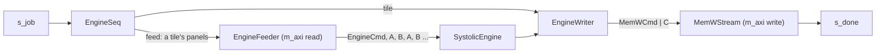

# Systolic engine behind memory

`SystolicEngineMem` (`waveflow/linalg/systolic_engine_mem.py`) computes `C = q(A·B)` or `C = q(Aᴴ·B)`
for matrices larger than the [systolic engine](systolic_engine.md) holds, with the operands and the
result in memory. It *contains* a `SystolicEngine` -- same parameters, same arithmetic, bit-exact with
`waveflow.linalg.matmul.matmul` -- and adds the outer loop: it covers `C` in tiles of `Mmax × Nmax`,
each one engine command whose panels are read from memory as the engine takes them.

All numbers here: Vitis HLS / Vivado xsim **2025.1**, `xczu48dr-ffvg1517-2-e`, 4 ns, the engine's
centre configuration (`Mmax 8, Kmax 8, Nmax 32, Pmax 4, R 4, C 8, L 4`), 12-bit operands.

## The job

On `s_job`, one `EngineJobDesc` per product:

| Field | Meaning |
|---|---|
| `tx_id` | the job's id, echoed in its `EngineDone` |
| `op` | `MUL` or `MUL_AH` |
| `M`, `K`, `N` | `C` is `M × N`; `A` is `M × K` (`K × M` for `MUL_AH`), `B` is `K × N` |
| `a_base`, `b_base`, `c_base` | the first word of `A`, `B` and `C` in memory |

When the last tile of `C` is in memory, the job's `EngineDone` (`tx_id`, `status`) goes to `s_done`.

**The rules.** `M`, `K`, `N` are multiples of `Mmax`, `Kmax`, `Nmax`, and `K ≤ Pmax · Kmax`: the partial
sums of a tile stay on chip, so a longer `K` needs a larger `Pmax`. A job that breaks one is answered
`BAD_OP` or `BAD_DIMS` with no write. Pad other shapes with zeros.

```python
from waveflow.linalg.systolic import MatmulOp
from waveflow.linalg.systolic_engine_mem import EngineJobDesc, job_status

for tx, (M, K, N) in enumerate([(64, 32, 128), (64, 40, 128), (12, 8, 32)], start=1):
    d = EngineJobDesc()
    d.tx_id, d.op, d.M, d.K, d.N = tx, MatmulOp.MUL, M, K, N
    print(tx, job_status(d, Mmax=8, Kmax=8, Nmax=32, Pmax=4).name)
```

```text
1 OK
2 BAD_DIMS
3 BAD_DIMS
```

**Memory is block-major** (`block_major`), so each panel and tile is one burst: `A`'s panel `(i, p)` at
`a_base + (i·P + p)·wa`, `B`'s `(p, j)` at `b_base + (p·NT + j)·wb`, `C`'s tile `(i, j)` at
`c_base + (i·NT + j)·wc` -- `P = K/Kmax` panels, `NT = N/Nmax` column tiles, and `wa`, `wb`, `wc` the
words of one panel or tile. `read_c` reads `C` back into a matrix.

## Architecture



**The sequencer** checks the job and runs the output-stationary loop: per tile `(i, j)` of `C`, it sends
the feeder where `A(i, 0)` and `B(0, j)` are and the step between `B`'s panels, and the writer the tile's
`C` address and whether it is the job's last.

**The feeder** owns the read port. Per tile it writes the engine command (`npanels = K / Kmax`), then
`A(i,0) B(0,j) A(i,1) B(1,j) ...` -- the order the engine takes them -- a burst loop per operand panel, a
word a cycle.

**The writer** turns each tile's `Resp | C` from the engine into `MemWCmd(C(i, j)) | C` for the
framework's in-band memory writer, with the job's `EngineDone` behind its last tile. The `m_axi` reader
and writer of one generated top must fire equally often (their pointer FIFOs couple them): the feeder
fires once a tile and the writer writes once a tile, so they balance.

**Traffic.** Each tile reads its `A` row panels and `B` column panels, so `A` is read `N / Nmax` times and
`B` `M / Mmax` times ([memory](systolic_theory.md#memory)).

## Performance

Measured at RTL at the centre ([the example](../../../examples/systolic/timing.md#the-wrapper)): `C`
exact on every path of the loop, and a `32×32×64` product (8 tiles of 4 panels) in **6,468 cycles with
64-bit words and 3,680 with 128-bit**. The read port sets the pace, not the engine: each tile reads its
panels in bursts, a burst loop per panel, and the port idles ~12 cycles at each switch between loops.
Why the feeder reads that way -- three readers were measured -- and the
[harness and gates](../../../examples/systolic/test.md) are in the example.

## Limits

- **`K ≤ Pmax · Kmax`.** No accumulation through memory yet: a longer `K` needs a larger `Pmax`.
- **Tiles are the maxima.** Every tile is `Mmax × Nmax`, `Kmax` per panel; other shapes pad.
- **The read port idles between bursts, and binds.** Each switch between the feeder's burst loops
  costs ~12 idle cycles, 8 switches a tile. Removing it needs bursts that overlap across loops (`hls::burst_maxi`,
  which the generated top does not yet declare) or deeper buffering of `B`, so `A` and `B` can each be
  read in one run.
- **No reuse across tiles.** A tile reads its panels whether or not the last tile read the same `A`.
- **Not calibrated.** Its time in pysim is the sum of its tasks' seeded times.
