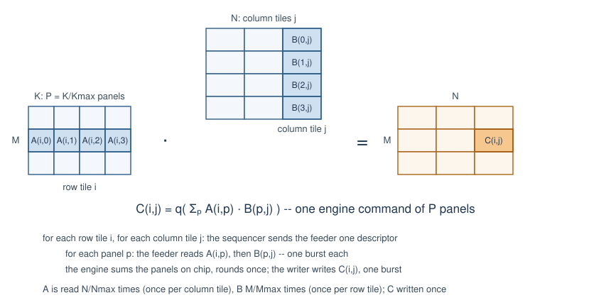
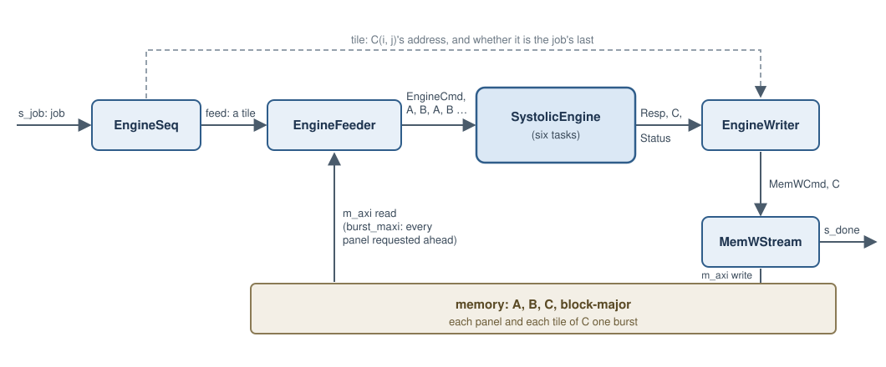

# Systolic engine behind memory

`SystolicEngineMem` (`waveflow/linalg/systolic_engine_mem.py`) computes `C = q(A·B)` or `C = q(Aᴴ·B)`
for matrices larger than the [systolic engine](systolic_engine.md) holds, with the operands and the
result in memory. It *contains* a `SystolicEngine` -- same parameters, same arithmetic, bit-exact with
`waveflow.linalg.matmul.matmul` -- and adds the outer loop: it covers `C` in tiles of `Mmax × Nmax`,
each one engine command whose panels are read from memory as the engine takes them.

All numbers here: Vitis HLS / Vivado xsim **2025.1**, `xczu48dr-ffvg1517-2-e`, 4 ns, the engine's
centre configuration (`Mmax 8, Kmax 8, Nmax 32, Pmax 4, R 4, C 8, L 4`), 12-bit operands.

## The job

On `s_job`, one `EngineJobDesc` per product:

| Field | Meaning |
|---|---|
| `tx_id` | the job's id, echoed in its `EngineDone` |
| `op` | `MUL` or `MUL_AH` |
| `M`, `K`, `N` | `C` is `M × N`; `A` is `M × K` (`K × M` for `MUL_AH`), `B` is `K × N` |
| `a_base`, `b_base`, `c_base` | the first word of `A`, `B` and `C` in memory |

When the last tile of `C` is in memory, the job's `EngineDone` (`tx_id`, `status`) goes to `s_done`.

**The rules.** `M`, `K`, `N` are multiples of `Mmax`, `Kmax`, `Nmax`, and `K ≤ Pmax · Kmax`: the partial
sums of a tile stay on chip, so a longer `K` needs a larger `Pmax`. A job that breaks one is answered
`BAD_OP` or `BAD_DIMS` with no write. Pad other shapes with zeros.

```python
from waveflow.linalg.systolic import MatmulOp
from waveflow.linalg.systolic_engine_mem import EngineJobDesc, job_status

for tx, (M, K, N) in enumerate([(64, 32, 128), (64, 40, 128), (12, 8, 32)], start=1):
    d = EngineJobDesc()
    d.tx_id, d.op, d.M, d.K, d.N = tx, MatmulOp.MUL, M, K, N
    print(tx, job_status(d, Mmax=8, Kmax=8, Nmax=32, Pmax=4).name)
```

```text
1 OK
2 BAD_DIMS
3 BAD_DIMS
```

## Dividing a large product



The engine holds at most an `Mmax × Nmax` output and `Pmax` panels of `Kmax`. A larger product is
divided two ways:

- **`C` into tiles** of `Mmax × Nmax`: `MT = M / Mmax` row tiles by `NT = N / Nmax` column tiles.
- **The inner dimension into panels** of `Kmax`: `P = K / Kmax`, at most `Pmax`. `A` is then a grid of
  `Mmax × Kmax` blocks `A(i, p)` -- row tile `i`, panel `p` -- and `B` a grid of `Kmax × Nmax` blocks
  `B(p, j)`.

Tile `C(i, j)` is the product of row tile `i` of `A` and column tile `j` of `B`:

```
C(i, j) = q( A(i,0)·B(0,j) + A(i,1)·B(1,j) + … + A(i,P−1)·B(P−1,j) )
```

-- one [engine command](systolic_engine.md#the-command) of `P` panels, which the engine sums on chip and
rounds once ([panels](systolic_engine.md#panels-a-long-inner-dimension)).

**How the tiles and panels are iterated.** The loop is **output-stationary**: a tile's sums stay in the
engine while its panels stream past, and `C(i, j)` is written once, finished.

```
for i in 0 … MT−1:                 row tiles
    for j in 0 … NT−1:             column tiles: one engine command of P panels
        for p in 0 … P−1:          the feeder reads A(i,p), then B(p,j) -- a burst each
            the engine adds A(i,p)·B(p,j) into the tile's partial sums
        the engine rounds once; the writer writes C(i,j) -- one burst
the job's EngineDone, after its last tile
```

Consecutive tiles overlap: while the engine sweeps a tile, the feeder is already reading the next tile's
first panels, and the writer is writing the last tile's `C`. `A`'s row tile `i` is read once for each of
the `NT` column tiles, and `B`'s column tile `j` once for each of the `MT` row tiles -- `A` read `N / Nmax`
times and `B` `M / Mmax` times, `C` written once ([memory](systolic_theory.md#memory)).

**Memory is block-major** (`block_major`), so each block and each tile is one burst: `A(i, p)` at
`a_base + (i·P + p)·wa`, `B(p, j)` at `b_base + (p·NT + j)·wb`, `C(i, j)` at `c_base + (i·NT + j)·wc`,
with `wa`, `wb`, `wc` the words of one block or tile. `read_c` reads `C` back into a matrix.

## Architecture



**The sequencer** checks the job and runs the output-stationary loop: per tile `(i, j)` of `C`, it sends
the feeder where `A(i, 0)` and `B(0, j)` are and the step between `B`'s panels, and the writer the tile's
`C` address and whether it is the job's last.

**The feeder** owns the read port, an `hls::burst_maxi` (the endpoint's `burst_maxi = True`). Per tile
it writes the engine command (`npanels = K / Kmax`), requests every panel's read ahead --
`A(i,0) B(0,j) A(i,1) B(1,j) ...`, the order the engine takes them -- and reads all their words in one
loop, a word a cycle: the requests queue in the `m_axi` adapter, so the port does not wait between
panels.

**The writer** turns each tile's `Resp | C` from the engine into `MemWCmd(C(i, j)) | C` for the
framework's in-band memory writer, with the job's `EngineDone` behind its last tile. The `m_axi` reader
and writer of one generated top must fire equally often (their pointer FIFOs couple them): the feeder
fires once a tile and the writer writes once a tile, so they balance.


**Simulating it.** `SystolicEngineMem(pysim="flat")` runs the engine inside it as one process
([the flat pysim](systolic_engine.md#the-flat-pysim)); the sequencer, feeder, writer and memory writer
run as tasks either way. The `big` product's run length is the same within a cycle, and its Python calls
18% fewer.

## Performance

Measured at RTL at the centre ([the example](../../../examples/systolic/timing.md#the-wrapper)): `C`
exact on every path of the loop, and a `32×32×64` product (8 tiles of 4 panels) in **5,813 cycles with
64-bit words and 3,033 with 128-bit** -- 88% and 85% of the input's floor. The read port sets the pace,
not the engine. Why the feeder reads that way -- five readers were measured -- and the
[harness and gates](../../../examples/systolic/test.md) are in the example.

## Limits

- **`K ≤ Pmax · Kmax`.** No accumulation through memory yet: a longer `K` needs a larger `Pmax`.
- **Tiles are the maxima.** Every tile is `Mmax × Nmax`, `Kmax` per panel; other shapes pad.
- **The read port binds.** With every panel requested ahead it is busy 85 to 88% of the time; the
  rest is the adapter's gaps between bursts and the feeder's command a tile.
- **No reuse across tiles.** A tile reads its panels whether or not the last tile read the same `A`.
- **Not calibrated.** Its time in pysim is the sum of its tasks' seeded times.
