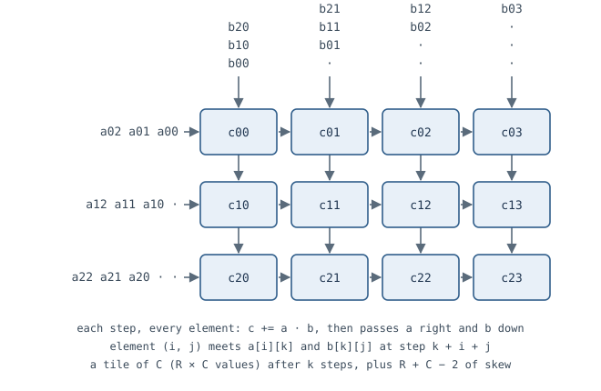

# How a systolic array works

This page describes the array of [`SystolicEngine`](systolic_engine.md) on one **panel**: one pass
of the inner dimension through the array. It defines the dimensions the other pages use and works out
what bounds a panel's time and memory. How the engine schedules its array is on its own page.

## The dimensions

The product is `C = A·B` (or `Aᴴ·B`):

| Symbol | Meaning | At the centre |
|---|---|---|
| `m`, `n` | rows and columns of `C` | 8, 32 |
| `kp` | the inner dimension of one panel: `A` is `m × kp`, `B` is `kp × n` | 8 |
| `K` | the whole inner dimension, `npanels · kp` (the engine sums panels on chip) | 8 to 32 |
| `R`, `C` | the array: `R` rows by `C` columns of processing elements | 4, 8 |
| `L` | lanes: the outputs written per step, a lane group of `L` complex values | 4 |
| `LW` | elements per stream or memory word (two at 64 bits, four at 128, with 16-bit lanes) | 2 or 4 |

`C` names both the result and the array's column count, as in the code; a code-font `C` next to
`R` is the array. Each element of `A`, `B` and `C` is a complex fixed-point value.

## One element, one tile



The array is **output-stationary**: element `(i, j)` holds one value of `C` and adds one complex
product to it every step. `A` enters from the left, a row of `A` per row of the array, and moves
right one element a step; `B` enters from the top, a column per column of the array, and moves down.
Row `i` starts `i` steps late and column `j` starts `j` steps late (the **skew**), so element
`(i, j)` meets `a[i][kk]` and `b[kk][j]` at step `kk + i + j` and, after all `kp` of them, holds
`c[i][j] = Σ a[i][kk]·b[kk][j]`.

**Output-stationary or weight-stationary.** The other common dataflow is **weight-stationary** (the
TPU's): `B` is preloaded, one value per element, `A` streams in, and the partial sums flow down the
array and leave from its bottom row, finished. It pays when one `B` serves many rows of `A` -- a
network's weights -- so the cost of loading it is spread thin; but the sums travel element to element
at accumulator width. Output-stationary keeps the wide, exact sums still and moves only the narrow
operands, and a tile's sum can be stored and resumed, which is how a long `K` is summed in panels with
one rounding at the end; its cost is reading the results out afterwards
([How long a tile takes](#how-long-a-tile-takes)). Here `A` and `B` change from job to job, so nothing
is preloaded to reuse, and the exact sums matter: output-stationary.

The `R × C` values the array computes at once are a **tile** of `C`. A product of `m × n` has

```
T = (m / R) · (n / C)
```

tiles. At the centre, `T = 2 · 4 = 8`.

## How long a tile takes

One tile needs `kp` steps of products, but alone it takes longer:

- **the skew**: the last element, `(R−1, C−1)`, starts `R + C − 2` steps after the first;
- **the drain**: its `R·C` results leave `L` at a time, `R·C/L` steps.

Done one tile at a time, a tile costs about `kp + R + C − 2 + R·C/L` steps (at the centre,
`8 + 10 + 8 = 26`).

The skew and the drain can overlap the next tile instead. When the next tile's first values arrive,
each element moves its finished sum into a shadow register and starts again; the shadows drain
while the new tile computes. Tiles then follow each other every

```
P = max(kp, R·C/L, L)
```

steps: at least `kp` (the products), at least `R·C/L` (the drain has to keep up), and at least `L`
(a shadow is not overwritten before it is drained). That is how `SystolicEngine` runs
([its architecture](systolic_engine.md#architecture)); at the centre `P = 8`.

## Three bounds on a panel

With one word a cycle in and one out, a panel cannot take less time than any of these:

| Bound | Cycles a panel | At the centre, 64-bit words | 128-bit words |
|---|---|---|---|
| **compute**: every tile, at the period | `T · P` | 64 | 64 |
| **input**: `A` and `B` | `kp · (m + n) / LW` | 160 | 80 |
| **output**: `C`, once per output (after its last panel) | `m · n / LW` | 128 | 64 |

The largest is the bound. The input carries `kp · (m + n)` values for `m · n · kp` products, so the
array is **compute-bound** -- each value used enough times to keep `R·C` elements busy -- when

```
m · n / (m + n)  ≥  R · C / LW      (with kp ≥ R·C/L and kp ≥ L)
```

At the centre `m·n/(m+n) = 6.4`: below `R·C/LW = 16` at 64-bit words and below 8 at 128, so the
array is input-bound at both. Square products of `m = n = 32` (16) would be compute-bound at
64-bit words, and `m = n = 16` (8) at 128.

**Short panels move the bound to the output.** At `kp = 1` the compute bound stays `T · P = 64`
(the period cannot drop below `R·C/L = 8`) and the input drops to `40 / LW`, but `C` is still
`m·n = 256` values: the output, 128 cycles at 64-bit words, binds.

**Against the RTL.** The engine at the centre takes 175 cycles a product with 64-bit words (the input
bound, 160, plus the command), 141 at `kp = 1` (the output bound, 128, plus the reply header) and 94
with 128-bit words, where the compute bound's 64 steps plus ~30 cycles of fixed cost a command meet the
input's 80 words plus its command -- measured in
[the example](../../../examples/systolic/timing.md#the-engine-against-its-bounds).

## Memory

A panel needs its operands and result on chip:

| Buffer | Values | At the centre (24-bit complex values) |
|---|---|---|
| `A` | `Mmax · Kmax` | 64 values, 1,536 bits |
| `B` | `Kmax · Nmax` | 256 values, 6,144 bits |
| `C` | `Mmax · Nmax` | 256 values, 6,144 bits |
| the array | `R · C` sums at accumulator width, and as many shadows | 32 + 32 |
| partial sums between panels | `Mmax · Nmax` at accumulator width | 256 |

Each operand and result buffer is **double-buffered** -- one block in use, the next being filled
-- so loading, computing and storing overlap; the buffers are sized to the maxima, whatever a job's
own size.

**Banking.** A block RAM gives one or two accesses a cycle, and the array needs many values a step, so
each buffer is laid out -- partitioned, in HLS terms -- to match how it is read:

| Buffer | Layout | Why |
|---|---|---|
| `A` (held as `X`) | a bank per row of the array | every row reads its own `X[i][kk]` at the same step |
| `B` | a bank per column of the array | every column reads its own `B[kk][j]` at the same step |
| `C` | one memory of lane groups: `L` values a word | a drain step writes `L` adjacent values of a row, and the store reads them together |
| partial sums | a bank per element | every element reads its own partial sum as its next tile starts |

Without the banks the reads of one step would queue on one memory port, and the step would take `R`
or `C` cycles instead of one. `C` needs no banks because its `L` values are adjacent: one wide word
carries them, so `L` is both the outputs drained a step and the width of a `C` word.

A product larger than the buffers is cut into panels (a longer `K`, summed on chip) and
into tiles of `C` held while panels of `A` and `B` stream past -- the outer loop of
[`SystolicEngineMem`](systolic_engine_mem.md#architecture), which reads `A` once per
column of tiles (`N / Nmax` times) and `B` once per row of tiles (`M / Mmax` times) instead of once.
