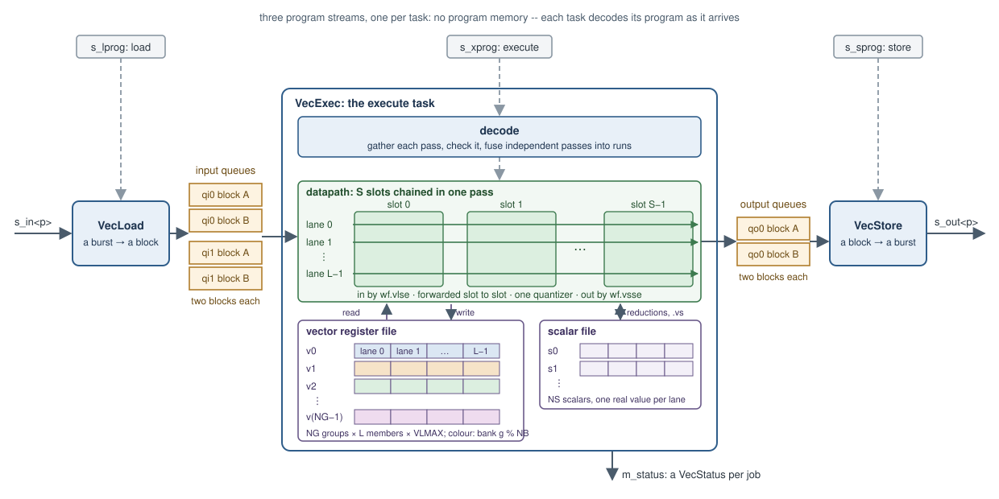
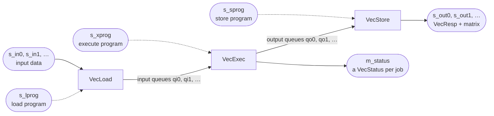

# Vector unit architecture

This page describes what the vector unit is made of. [How a vector processor works](theory.md)
explains the ideas. Every size and every format is a **build parameter**: a field of `VecUnitConfig`
(`waveflow/vecunit/config.py`), fixed when the hardware is generated. Changing one gives a different
piece of hardware, while a program can change from job to job. The examples use the toy unit of
`examples/vecunit/toy.py`:

```python
from dataclasses import replace

import numpy as np

from examples.vecunit import toy as T
from waveflow.vecunit import isa as I
from waveflow.vecunit.asm import Programs, check

cfg = T.toy_config()
print(f"NG={cfg.NG} groups, NS={cfg.NS} scalars, NQI={cfg.NQI} in / NQO={cfg.NQO} out queues")
print(f"L={cfg.L} lanes, VLMAX={cfg.VLMAX}, S={cfg.S} slots, NB={cfg.NB} banks")
print(f"blocks up to Kmax={cfg.Kmax} x Nmax={cfg.Nmax}, {cfg.word_bits}-bit data words")
```

```text
NG=4 groups, NS=3 scalars, NQI=2 in / NQO=1 out queues
L=4 lanes, VLMAX=16, S=3 slots, NB=4 banks
blocks up to Kmax=16 x Nmax=4, 64-bit data words
```

## The block diagram



Data flows left to right. The load task turns each input burst into a block of an input queue. The
execute task's **decoder** reads the execute program, gathers each pass, checks it and fuses
independent passes into runs. It then drives the **datapath**: `S` slots, one per instruction of a
pass, each `L` lanes wide. On every cycle each lane takes the next element of its member through all
the slots, each slot's result forwarded to the next. The datapath reads the input queues (`wf.vlse`),
the **vector register file** and the **scalar file**. It writes results back to them or to the output
queues (`wf.vsse`), and the store task turns each output block into a burst. The sections below
describe each block.

**There is no program memory.** Each task reads its own program stream and decodes each instruction
as it arrives. A program is never stored and never jumped within, which is why it is straight-line.
A loop, such as strip-mining, is unrolled when the program is built in Python. The decoder reads one
instruction word ahead, to see whether a chain continues, but it does not decode ahead of the
datapath: decoding a pass costs cycles of its own, the largest share of a CG job's time (see
[the limits](timing.md#limits)).

## The three tasks



| Task | Takes | Does |
|---|---|---|
| `VecLoad` | the load program on `s_lprog`, data on `s_in<p>` | per `wf.ld q, port, k, n`: the next burst on input `port`, a `k × n` matrix, landed as the next block of input queue `q` |
| `VecExec` | the execute program on `s_xprog` | runs the program on the register and scalar files, reading input blocks and filling output blocks; one `VecStatus` per job on `m_status` |
| `VecStore` | the store program on `s_sprog` | per `wf.st port, q, tag, k, n`: output queue `q`'s next block onto output `port`, headed by a `VecResp` |

The three are free-running tasks: each loops forever, taking one program after another, and
waits only when a queue it needs is empty or full. In pysim they are three `FreeRunMod` modules
inside the composite `VecUnit` (`waveflow/vecunit/unit.py`). In hardware each is one `hls::task`.
The load and store tasks never compute and the execute task never touches a port: this is the
[decoupled access/execute](theory.md#decoupled-access-and-execute) split.

## The vector register file

The vector registers are `NG` **groups** (`v0` .. `v{NG-1}`). A group is `L` **members**, one per
lane, and each member holds up to `VLMAX` complex elements, so a group holds `L × VLMAX` values.
Every vector instruction names whole groups.

The hardware has to deliver several operands every cycle: a pass of three slots can read three groups
and write three. One memory, with its two ports, cannot do that, so the groups are spread over `NB`
**banks** per lane, separate memories with their own ports. Group `g` lives in bank `g % NB`. That
gives the rule every pass must keep:

- **one read per bank:** the groups a pass reads from the register file sit in different banks. A
  group read once serves every slot that names it, and a value an earlier slot of the same pass
  wrote is **forwarded** to later slots and does not count;
- **one write per bank:** the groups a pass writes sit in different banks.

Two groups in one bank are a **bank conflict**. The hardware refuses a pass that has one, and so does
the assembler. In the toy unit every group has a bank of its own. With two banks instead, `v0` and
`v2` share bank 0, and a pass that reads both is refused:

```python
two = replace(cfg, NB=2)
print("banks:", [two.bank(g) for g in range(two.NG)])
p = Programs(load=[I.ld(0, 0, 4, 4)],
             execute=[I.setvl(4), I.vlse(0, 0, 0, 1), I.vlse(2, 0, 0, 1),
                      I.vadd_vv(1, 0, 2).c, I.vsse(0, 1, 0, 1),     # reads v0 and v2: bank 0 twice
                      I.qpop(0), I.qpush(0)],
             store=[I.st(0, 0, 0, 4, 4)])
print(check(two, p)[0])
print(check(cfg, p))
```

```text
banks: [0, 1, 0, 1]
execute[3] vadd.vv.c v1, v0, v2: the pass breaks a pass rule (slots and capabilities, one group read and written per bank, one access per queue, no reduction read in its own pass)
[]
```

A program avoids conflicts by choosing its registers: CG's program gives each column group's `X`,
`R`, `P`, `S` the groups `4g .. 4g+3`, so with four banks each kind of vector has a bank to itself.
Banking the vector register file to serve several operands at once is how RVV implementations such as
Ara build theirs. In this unit's hardware a bank of one lane is one block RAM.

The register file lives for **one job**. A job cannot see another job's registers, so a program must
write a register before it reads it, which the assembler checks.

## The scalar file

The `NS` **scalars** (`s0` .. `s{NS-1}`) are real values, one per lane: `s[l]` belongs to lane `l`,
so each column's problem has its own. Scalars come from three places:

- a **reduction**, `wf.vdotr s, va, vb`, which sums `Re(conj(va)·vb)` over the `VL` elements of each
  member, or `wf.vmv.s.v s, va`, which takes element 0 of each member; both deliver at the end of
  their pass;
- a **scalar instruction**: `wf.sdivz` divides one scalar by another (0 for a zero divisor) and
  `wf.smv` copies one;
- an **immediate**: `wf.sli s, imm` sets every lane's `s` to a constant from the program.

They are used by the `.vs` instructions: a scalar times a vector (`wf.vmul.vs`), a scalar added to or
subtracted from a vector's real part (`wf.vadd.vs`, `wf.vsub.vs`), and the in-place multiply-adds
(`wf.vmacc.vs`, `wf.vnmsac.vs`, `wf.vmadd.vs`). There is no other scalar arithmetic. The toy kernels
show them: `gain` computes its scalars, `poly` takes them as constants (see the
[program examples](program_examples.md)).

## Queues and blocks

A **queue** carries **blocks** between two tasks. Each holds two blocks, so the producer can fill
one while the consumer uses the other. There are `NQI` input queues (load → execute) and `NQO` output
queues (execute → store).

A block holds one `k × n` matrix (`k ≤ Kmax`, `n ≤ Nmax`), stored as **rows of lane groups**. A
**lane group** is `L` consecutive columns of one row, the values the `L` lanes take in one cycle. A
row of `n` columns takes `ceil(n / L)` lane groups. `L` need not divide `n`: the last group's
spare lanes are zero. Here is a `2 × 6` matrix in a unit of four lanes that allows eight columns:

```python
from waveflow.vecunit.model import block_from_matrix

wide = replace(cfg, Nmax=8)
m = np.arange(12).reshape(2, 6)
blk = block_from_matrix(m, np.zeros_like(m), wide)
print("lane groups a row:", wide.groups_per_row(6))
print(blk.re[:4])
```

```text
lane groups a row: 2
[[ 0  1  2  3]
 [ 4  5  0  0]
 [ 6  7  8  9]
 [10 11  0  0]]
```

Row `i`'s column group `g` is lane group `i · ceil(n / L) + g`. The execute task reads a block with
`wf.vlse vd, q, g, stride`, a **strided** read: element `i` of member `l` of `vd` is the block's
value at row `i`, column `g·L + l`. That is lane group `i · stride + g`, so `stride` is
`ceil(n / L)`. It writes one with `wf.vsse q, vs, g, stride`. The matched filter, with eight
antennas on four lanes, reads two column groups a chunk, `g` = 0 and 1. The toy kernels keep `n ≤ L`,
one column group, so `g = 0` and `stride = 1`.

**Taking and giving back a block.** The execute task takes an input queue's next block at the first
`wf.vlse` that reads it, and gives it back with `wf.qpop`: only then can the load task refill that
buffer. It takes an output queue's next block at the first `wf.vsse`, and hands it to the store task
with `wf.qpush`. A task that finds no block waits. This is all the synchronization the unit has: the
block's lock is the token that, in VTA, is a separate dependency queue.

## Slots

A pass runs up to `S` chained instructions, each in a **slot**, slot `s` for the pass's `s`-th
instruction. Slots cost hardware, multipliers above all: a complex multiplier is four DSP blocks per
lane. So each slot has a **capability mask** (`slot_caps[s]`, a `Cap`) of the operation classes it
has hardware for:

| `Cap` | Instructions |
|---|---|
| `MOVE` | `vmv.v.i`, `vmv.v.v`, `vadd.vv`, `vsub.vv` |
| `MUL` | `vmul`, `vmacc`, `vnmsac`, `vmadd` and their `.vs`, conjugate and broadcast forms; `wf.vmul.vs`, and `wf.vadd.vs` / `wf.vsub.vs` (the scalar enters through the multiplier's operand path) |
| `DOT` | `wf.vdotr`, `wf.vmv.s.v` (the accumulator delivers it) |
| `LOAD` | `wf.vlse` |
| `STORE` | `wf.vsse` |

By default every slot has every class. A slot without `MUL` and `DOT` is built without a multiplier,
and one without `DOT` without an accumulator. A pass whose instruction lands in a slot without the
class it needs is refused, like a bank conflict.

```python
print([hex(c) for c in cfg.slot_caps])
```

```text
['0x1f', '0x1f', '0x1f']
```

## Formats

Every vector group, every scalar and every queue has its own fixed-point format: a
`waveflow.utils.fixputils.Format` of width, integer bits, rounding and overflow. The toy unit keeps
one format for all of its vectors and queues (`FV`, 16 bits with 3 integer bits) and gives its scalars
wider ones. The matched filter uses three vector formats, and CG one per kind of vector.

The datapath is built for all the formats at once. On every read an operand is converted exactly into
the **union format**, which has the most integer bits and the most fraction bits of any vector
format. Products and sums are exact, and a result is rounded and saturated once, by one shared
quantizer whose shift, rounding bit and saturation bounds are selected by the destination's format.
The scalars have a union of their own:

```python
for name, f in (("vector", cfg.vector_union()), ("scalar", cfg.scalar_union())):
    print(f"{name} union: {f.W} bits, {f.int_bits} integer")
```

```text
vector union: 16 bits, 3 integer
scalar union: 32 bits, 12 integer
```

The union's width is a cost. Formats whose integer and fraction bits spread widely build wide
multipliers and a wide quantizer: integer parts from 1 to 14 bits gave 52-bit results and a csynth of
more than 50 minutes (Vitis HLS 2024.1, `plans/vecunit_new.md` Stage 5). Keep a unit's formats
close, as an application's usually are.

**The result shift.** A multiplying instruction's product can be scaled by `2^−RS` before its one
rounding (`wf.setrs`, or the instruction's own shift; see the [examples](program_examples.md)). The
datapath carries `rs_max` more fraction bits for it (a build parameter, 0 by default) and shifts the
product left by `rs_max − RS`, so the scaling is exact and the quantizers keep their constant
shifts. `rs_max = 0` builds neither; the CG and matched-filter units are built that way. Likewise the
scalar extensions (`wf.vmul.vs`, `wf.vadd.vs`, `wf.vsub.vs`, `wf.vmv.s.v`, `wf.sli`) are built only
with `scalar_ext` ([the options](construct.md#the-options)).

## Ports and words

Data enters on `n_in_ports` input streams (`s_in0`, ...) and leaves on `n_out_ports` output streams
(`s_out0`, ...), each of `word_bits`-bit words (64 or 128). On a port, a value is a **memory element**:
each part, real and imaginary, is `lane_bits` wide (16) with the queue format's integer bits
(`waveflow.linalg.formats.mem_format`), the layout the [linear-algebra components](../linalg_common.md)
share. So a 64-bit word carries two complex values, and a 128-bit word four. Each matrix on an
output port is headed by its `VecResp`. The three programs and the status travel on 64-bit streams
of their own.

## Jobs, programs and status

A **job** is three programs, one for each task, sent as three framed bursts: a `VecJob(tx_id,
ninstr)` word, then `ninstr` instruction words. The three carry the same `tx_id`. The execute task
answers each job with one `VecStatus(tx_id, status)` on `m_status`, and each `wf.st` heads its matrix
with a `VecResp(tx_id, tag, k, n)`. This is the [command-response protocol](../../systems/command_response.md)
the other Waveflow accelerators follow.

The execute task checks every instruction and every pass. An unknown operation, an index out of
range or a pass that breaks a rule stops the job with a status other than `OK`, and **an error is
fatal**: the unit takes no more input until it is reset. The assembler refuses every program the
hardware would refuse, and also programs whose result would be undefined, such as a read of a
register never written. [The instruction-set page](isa.md) lists the rules, and
[the programming page](programming.md) shows the checks at work.

## What it does not have

A program is **straight-line**: there are no branches, no loops in hardware and no conditional
execution (masks), so a loop such as strip-mining is unrolled when the program is built in Python. The
unit does not address memory: data arrives in the order the load program expects. Elements are
complex. The unit runs one job at a time. Each of these is a deliberate omission for the
linear-algebra jobs the unit was built for, and each is listed with the others in
[the limits](timing.md#limits).
