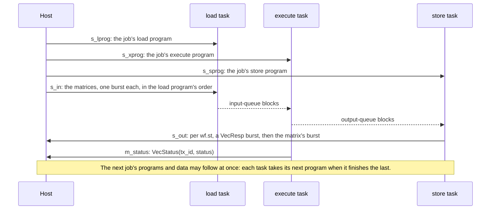

# Vector unit interface

This page is the unit's protocol: what a host sends to run a job, what comes back, in what order and
in what words. The host may be software, another accelerator, or -- in simulation and at RTL -- the
unit's harness, which drives each stream from a file of bursts. Everything travels on
**streams** of words grouped into **bursts**: in hardware, AXI4-Stream channels, a burst ending with
the word that carries `TLAST`.

## The streams

| Stream | Direction | Words | Carries |
|---|---|---|---|
| `s_lprog` | in | 64-bit | the load program of each job |
| `s_xprog` | in | 64-bit | the execute program of each job |
| `s_sprog` | in | 64-bit | the store program of each job |
| `s_in0`, `s_in1`, ... | in | `word_bits` | the matrices the load programs take, one burst a matrix |
| `s_out0`, `s_out1`, ... | out | `word_bits` | the matrices the store programs send, each a `VecResp` burst then the matrix's burst |
| `m_status` | out | 64-bit | one `VecStatus` a job |

There is one input and one output data port unless the configuration asks for more (`n_in_ports`,
`n_out_ports`); each program stream feeds one task ([the architecture](architecture.md#the-three-tasks)).

## One job



To run a job, the host:

1. assembles its three programs, all with the job's `tx_id` (in Python, `waveflow.vecunit.asm.assemble`);
2. sends the load program on `s_lprog`, the execute program on `s_xprog`, the store program on
   `s_sprog`, one burst each, even when a program is empty;
3. sends on each input port the matrices that port's `wf.ld` instructions take, one burst a matrix, in
   their order;
4. reads, on each output port, what that port's `wf.st` instructions send, and on `m_status` the job's
   status.

Nothing has to be sent in step with anything else. The three tasks take their streams independently
and meet only at the queues, which stall whichever side is ahead. A host can send the programs and
data of many jobs ahead, and the unit overlaps them: the load task fills the next job's blocks while
the execute task works on this one.

## The words

The job below is the toy kernel `double`, `Y = X + X`, on a `2 × 4` matrix, `tx_id` 7. Its bursts, as
`waveflow.vecunit.workload.job_bursts` makes them for the harness, and what comes back, as
`golden_bursts` gives it from the interpreter:

```python
import numpy as np

from examples.vecunit import toy as T
from waveflow.vecunit.workload import golden_bursts, job_bursts

cfg = T.toy_config()
re = np.array([[1, 2, 3, 4], [5, 6, 7, 8]])
jobs = [(7, T.double_programs(2, 4), {0: [(re, -re)]})]
for stream, bursts in {**job_bursts(cfg, jobs), **golden_bursts(cfg, jobs)}.items():
    for b in bursts:
        words = np.asarray(getattr(b, "words", b), np.uint64).reshape(-1)
        print(f"{stream:8}", " ".join(f"{int(w):016x}" for w in words))
```

```text
s_lprog  0000000000010007 004002000000012b
s_xprog  0000000000060007 000002000000007b 001000000000202b 000000000001210b 00100000010000ab 00000000000000fb 000000000000017b
s_sprog  0000000000010007 00400200000001ab
s_in0    fffe0002ffff0001 fffc0004fffd0003 fffa0006fffb0005 fff80008fff90007
s_out0   0004000200000007
s_out0   fffc0004fffe0002 fff80008fffa0006 fff4000cfff6000a fff00010fff2000e
m_status 0000000000000007
```

**A program burst** is a `VecJob` word, then one word per instruction ([the encoding](isa.md#the-encoding)).
The `VecJob` word holds the job's `tx_id` in bits 15:0 and the instruction count `ninstr` in bits
31:16: `0x10007` is `tx_id` 7 with one instruction, `0x60007` `tx_id` 7 with six. An empty program is
its `VecJob` word alone, with `ninstr` 0. A burst whose length does not match its `ninstr` stops the
job with `BAD_LENGTH`.

**A data burst** is one `k × n` matrix: its elements in row-major order, packed into words. An element
is a **memory element**: its real part in `lane_bits` bits (16), then its imaginary part, each the
stored integer of its queue's format at `lane_bits` wide. A 64-bit word holds two elements, the first
in the low 32 bits; the last word is padded with zeros. So the first input word `fffe0002ffff0001` is
element (0, 0) `= 1 − 1j` in its low half (`ffff 0001`) and element (0, 1) `= 2 − 2j` in its high
half (`fffe 0002`). The burst holds `ceil(k·n / 2)` words, here 4. At 128 bits a word holds four
elements, at 32 bits one.

**An output matrix** comes as two bursts: its `VecResp` word -- `tx_id` (bits 15:0), the `wf.st`'s
`tag` (31:16), `k` (47:32) and `n` (63:48): `0004000200000007` is `tx_id` 7, tag 0, `2 × 4` -- then
the matrix, packed as an input matrix is. Here each element doubled: `2 − 2j`, `4 − 4j`, ...

**The status** is one `VecStatus` word a job: `tx_id` in bits 15:0, the status in bits 23:16 --
`0000000000000007` is `tx_id` 7, `OK`. The codes are on [the programming page](programming.md#errors).

## The ordering rules

- **Each stream is in order.** Jobs follow each other in the same order on the three program streams;
  each job sends one program on each, empty if its task has nothing to do.
- **Data follow the load programs.** On each input port, the matrices come in the order that port's
  `wf.ld` instructions run, job after job. Each matrix is one burst of exactly its `k × n` elements.
- **Results follow the store programs.** On each output port, the matrices go out in the order that
  port's `wf.st` instructions run, each headed by its `VecResp`; its `tx_id` and `tag` say which job
  and which store each is.
- **One status a job, in job order,** after the job's execute program has finished.

## Errors

An error the execute task finds -- an unknown or out-of-range instruction, a pass that breaks a pass
rule, a program burst of the wrong length -- stops the job: its status (not `OK`) goes out on
`m_status`, the outputs it had pushed before go out, and **the unit takes no more input** until it is
reset. A host that sees a status other than `OK` resets the unit.

Two kinds of error are **not reported yet**, and a host should guard against them with a timeout: a
load or store program instruction its task cannot run, and a data burst whose length differs from its
`wf.ld`'s `k × n`. Either stops a task without a status, and the unit then waits
(`plans/vecunit_future.md`, R1 and R2). The assembler refuses the first kind before a job is sent;
the second is the host's to get right.

## In Python, in pysim and at RTL

`job_bursts(cfg, jobs)` and `golden_bursts(cfg, jobs)` (`waveflow.vecunit.workload`) make exactly the
bursts above for a list of jobs, and a unit's `workload(kind)` and `golden(kind)` call them
([constructing a unit](construct.md#constructing-the-unit)). The harness drives them into the unit in
pysim and, through the same files, into the generated RTL under XSI, and compares every word that
comes back. In the generated top, each stream is an AXI4-Stream port of the same name.
