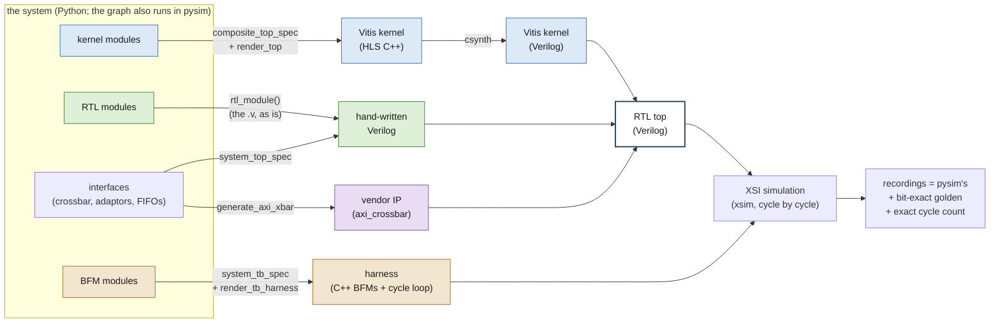

# Flow steps

The terms on this page are defined in [XSI simulation components](./concurrent_layers.md):

- the XSI simulation top;
- kernel, RTL and BFM modules;
- the RTL top;
- the Vitis kernel;
- the harness.

The steps are the same whether the design is one kernel or several devices behind a bus. The
[mem_copy example](../../examples/memcpy/) walks them for one kernel, and
[markov](../../examples/markov/) walks them for a system of devices with a software host.

## One Python object: a system

The flow starts from **one** Python object, a **system** ([`HwSystem`](../build/xsi_system.md#the-system)).
It holds two things:

- **The graph**: the design and everything around it, wired by interfaces exactly as in pysim. The
  same graph runs the pysim golden.
- **The cut**: which modules are the design under test (DUT). Everything else is testbench.

Each module of the graph plays one of the three [roles](./concurrent_layers.md#three-kinds-of-module),
and the cut decides which: kernel and RTL modules are inside it, BFM modules outside. Each role has
its own path to the XSI simulation:

The colours are those of the [system picture](./concurrent_system.md#a-system-in-one-picture):

| colour | what it is |
|---|---|
| blue | Vitis HLS: kernel modules, through csynth |
| green | hand-written RTL |
| purple | an interface realized as vendor IP |
| tan | the testbench |
| outlined box | the DUT's Verilog |

In the [mem_copy example](../../examples/memcpy/) the system is `MemCopySystem`, a
[`GraphSystem`](../build/xsi_system.md#graph-system) around the `MemCopyTB` graph, cut at the
kernel. Its modules fall into the three roles like this:

| role | in `mem_copy` | becomes |
|---|---|---|
| kernel modules | `MemCopy`, a composite of `Sequencer` → `MemRStream` → `MemWStream` | the Vitis kernel |
| RTL modules | none | — so the RTL top holds only the Vitis kernel |
| BFM modules | a `StreamDriver`, a `StreamSink`, and one `MemoryMod` behind both `m_axi` bundles | `AxisMaster`, `AxisSlave`, and a `FlatMemory` serving `AxiMmReadSlave` / `AxiMmWriteSlave` |

The harness arrow starts from the BFM modules, but the harness is derived from the **whole** system:
to know which BFM goes on which port of the RTL top, it has to see the cut and who is wired across it.

## The steps {#a-systems-steps}

**Describe the system.** A kernel module is a [`FreeRunMod`](./modules.md): either a leaf that
implements `run_iter`, or a composite that `add_comp`s children and wires internal channels with
`add_if`. The graph around it holds the BFM modules too: drivers, sinks, memories, a software host.

- For one kernel, a [`GraphSystem`](../build/xsi_system.md#graph-system) states only the graph, the
  cut (`dut_modules`), the scenario's inputs (`write_inputs`) and the golden (`check`).
- A system of devices builds its graph directly and states its cut as a tree of devices
  ([Systems and the cut](./concurrent_system.md)).

The system is all the remaining steps take. One call, `add_system_steps(dag, system)`, puts them on
a build DAG, and each is documented in [XSI system simulation](../build/xsi_system.md#running-it):

| step | what it does | colour ([picture](./concurrent_system.md#a-system-in-one-picture)) |
|---|---|---|
| **codegen** | the example's own: headers, each kernel's HLS top | |
| **[csynth](../build/xsi_system.md#csynth)** | Vitis, once per HLS top; re-run only when its sources change | blue |
| **[system_rtl](../build/xsi_system.md#system-rtl)** | the crossbar IP if the DUT has a bus, then the RTL top derived from the cut (a [`SystemTopSpec`](../build/xsi_system.md#the-spec)) | purple, green |
| **[scenario](../build/xsi_system.md#scenario)** | the stimulus both simulations read, and the run's cycle bound | |
| **[pysim](../build/xsi_system.md#pysim)** | the system in Python, from that scenario: what the testbench records | |
| **[system_xsi](../build/xsi_system.md#system-xsi)** | the harness of the BFM modules' C++ twins, compiled with the RTL and run cycle by cycle (optionally traced) | tan |
| **[compare](../build/xsi_system.md#compare)** | what the testbench recorded, RTL against pysim, word for word | |
| **system_synth** (opt-in) | the system through Vivado: [globally](../resource/systems.md#the-system-synthesis), or [per device, then linked](../resource/systems.md#per-device) | |

**Generate the Vitis kernel** (target `composite_kernel`). `composite_top_spec` walks the kernel
modules and `render_top` emits the Vitis kernel's top-level function in HLS C++:

- `ap_ctrl_none`;
- one `hls::task` per child;
- one internal FIFO per `add_if` edge;
- a port for every child endpoint left unwired (the boundary).

Task **bodies** come two ways: generated from a leaf's `run_iter` (`TaskBodyStep`), or hand-written
and declared with [`kernel_task()`](../comp_codegen/freerunning_override.md). `mem_copy`'s three are
hand-written framework bodies, copied in by `MemStreamStep`. This is the example's own codegen;
csynth then turns the top into the Vitis kernel's Verilog.

**The RTL top** (`system_rtl`). It is derived from the cut. Each kernel inside it is instantiated,
and every connection that crosses the cut becomes a port of the top, of its own kind:

- an AXI-Stream port for a stream;
- an AXI4 master group for an `m_axi` bundle facing a testbench memory;
- an AXI4 slave group for a bus master outside the DUT, such as the host.

A kernel with RTL modules beside it (a memory joined through `bram` ports) is instantiated as its
generated wrapper (`wrapper_gen`), worked in [A memory reached three ways](../../examples/bram_access/).
A system of devices gets a sub-top per device and the crossbar IP between them.

**The harness** (`system_xsi`). `system_tb_spec` binds each testbench participant's C++ twin, named
by its own [`bfm_model()`](../custom_hooks/bfm_model.md), to the top's ports, and checks that every
port is answered. `render_tb_harness` emits the harness: which models exist, which pins each drives,
and the cycle loop. The models themselves are pre-written
([`xsi_bfm.h`](../../../waveflow/build/xsi/xsi_bfm.h)); the harness only wires them. The full walk
is the [XSI testbench](../comp_codegen/xsi_tb.md) page. A software host is a BFM module like any
other, written as [software threads](../build/sw_threads.md): a `SwHost` whose threads are SimPy
processes in pysim and the same program in C++ under XSI.

**The gate.** Three claims, and none of them is "it ran":

- **`compare`**: what the testbench recorded (each sink's words, each memory's final arena, a host's
  traces) is the same at RTL as in pysim. A recording pysim cannot match by construction is marked
  `recording_check = "example"` and left to the example.
- **The golden**: the example's check, on the RTL's recordings; bit-exact.
- **An exact cycle count**: `mem_copy` = 2908 cycles for 16 jobs, markov 1870. A count that moves is
  a real behaviour change.

> The Vitis kernel and the harness are derived from the **same** object that runs the Python golden:
> one statement, two backends. That is what keeps the pysim model and the RTL from testing different
> things.

**Source of truth:**

- `waveflow/hw/hw_system.py`: `HwSystem`, `GraphSystem`.
- `waveflow/build/system_dag.py`: `add_system_steps`.
- `waveflow/build/system_top.py`: `system_top_spec`, `system_tb_spec`.
- `waveflow/build/composite_gen.py`: `composite_top_spec`, `render_top`, `render_tb_harness`.
- `waveflow/build/wrapper_gen.py`: a kernel's wrapper, when it has RTL modules.
- `waveflow/build/hwcodegen_steps.py`: `TaskBodyStep`.
- `tests/examples/test_*_xsi.py`: the gates.
