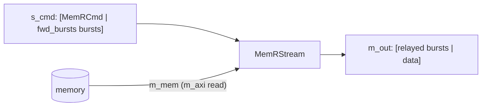
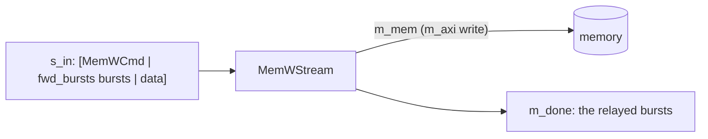

# Master side — streaming memory kernels

`MemRStream` and `MemWStream` (`waveflow/hw/mem_stream.py`) give memory a **command-based,
transactional interface**. Rather than a kernel reaching into an `m_axi` port directly, it sends a read
or write **command on a stream** and the component runs the burst: `MemRStream` turns a read command
into a word stream *out* of memory, `MemWStream` writes an incoming word stream *into* memory.

## Why a streaming interface to memory

A lone kernel could just own its `m_axi` port — the command stream earns its keep once the memory is
shared, or once the stage that asks for data is not the stage that uses it. Commands on a stream are a
simple substrate for **arbitration** (an arbiter multiplexes many requesters' commands onto one memory
port) and for **pipelines** (one stage decides what to fetch, and the data flows on to the next). In
both, whoever receives a burst has to know what it is. The in-band protocol answers that by carrying
the description *with* the data, so the memory stage holds no per-job state.

## Two protocols

Each component is constructed in one of two protocols, chosen by the `inband` build parameter:

| | in-band (`inband=True`) | two-stream (`inband=False`, the default) |
|---|---|---|
| command | `MemRCmd` / `MemWCmd`: `addr`, `len`, `fwd_bursts` | `MRCmd` / `MWCmd`: `addr`, `len` |
| what else rides along | `fwd_bursts` opaque bursts, relayed untouched | nothing |
| reader output | `[relayed bursts | data]` on `m_out` | the data on `m_out` |
| writer input | one stream: `[MemWCmd | relayed bursts | data]` on `s_in` | `MWCmd` on `s_cmd`, data on `s_in` |
| completion (`m_done`) | the writer's relayed bursts, after the write | one `MemComplete` (`len`) per command |
| streams | framed (TLAST) | plain |

**Use in-band.** Every curated design does — [MemCopy](../../../examples/memcpy/), the
[interleaver](../../../examples/interleaver/), [fir_block](../../../examples/firblock/), markov, the
systolic engine's memory harness — and the shipped timing calibration is fitted on its bodies. The
two-stream protocol is the original standalone kernel: a plain command, no relay. It remains for a
kernel that both issues a burst and consumes it, on plain streams, and needs no descriptor.

## Addressing — element coordinates, not bytes

In both protocols `addr` and `len` are **word/element** coordinates relative to a buffer base set once
with `bind_base()` (0 in hardware: a free-running top's pointers are `offset=off`, so there is no base
register -- [why](../../comp_codegen/freerunning_composite.md#how-a-pointer-reaches-a-task)). Every
command afterward is base-relative and unit-agnostic, and because `m_mem` is already a word pointer in
the generated C++, no byte↔word conversion happens in the kernel — unlike a byte-addressed `m_axi` port
(see [Endpoint interfaces](../../comp_codegen/interface.md)).

## MemRStream (in-band)

Reads a run of words from memory and emits them on a stream, after relaying whatever the command said
to relay.



**The command.** One `MemRCmd` per burst:

<!-- snippet: skip -->
```python
# From waveflow/hw/mem_stream.py
class MemRCmd(DataList):
    elements = {
        "addr":       {"schema": Word32, "description": "element/word offset to read from"},
        "len":        {"schema": Word32, "description": "number of packed words to read"},
        "fwd_bursts": {"schema": Word32,
                       "description": "opaque bursts to relay verbatim BEFORE the data"},
    }
```

The reader takes the next `fwd_bursts` bursts off `s_cmd` and writes them to `m_out` whole, **without
parsing them**, then appends the `len` words it read. Whatever the downstream stage needs to know —
the job's length, where its result goes, a transaction id — is a schema the issuing stage writes as one
of those bursts, and the downstream stage reads it with `get_schema` before the data. The reader never
knows what it carried, so one reader serves any application.

**Example.** The [interleaver](../../../examples/interleaver/)'s command receiver asks for two reads
per job: `P` with its descriptor `IlDesc` relayed ahead of it, then `X` with nothing relayed:

<!-- snippet: skip -->
```python
# From examples/interleaver/interleaver_inband.py -- CmdRxInband.run_iter
desc = IlDesc(n=n, y_off=cmd.y_off)
memr_p = MemRCmd(addr=cmd.p_off, len=nw, fwd_bursts=1)   # relay the next burst (IlDesc), then P
memr_x = MemRCmd(addr=cmd.x_off, len=nw, fwd_bursts=0)   # relay nothing, then X
yield from self.cmd_out.write(np.asarray(memr_p.serialize(word_bw=w), dtype=np.uint64))
yield from self.cmd_out.write(np.asarray(desc.serialize(word_bw=w), dtype=np.uint64))
yield from self.cmd_out.write(np.asarray(memr_x.serialize(word_bw=w), dtype=np.uint64))
```

The reader's output is the framed stream `[IlDesc | P | X]`, and the loader that takes it starts with
`desc = yield from self.s_in.get_schema(IlDesc)`.

## MemWStream (in-band)

The mirror: drains a word stream and writes it to memory. There is no separate command port — the
descriptor rides on `s_in` ahead of the data, so a command can never be paired with the wrong data.



**The command.** A `MemWCmd`, the same shape as `MemRCmd` (`addr`, `len`, `fwd_bursts`). The writer
**buffers** the `fwd_bursts` bursts that follow it, drains `len` data words and writes them
contiguously from `addr`, and only then emits the buffered bursts on `m_done`. `max_fwd_words` bounds
that buffer (the C++ body's fixed array).

**The completion.** Those relayed bursts *are* the completion: the stage that framed the write put its
own response there — `mem_copy`'s `CopyResp`, the interleaver's `IlDesc` — and the writer echoes it
once the memory has **acknowledged** the last write (its write response). A consumer that reads the
destination when the completion arrives therefore reads the new data. The write body orders the echo
after the response with an `hls::fence`; without it, Vitis 2025.1 sent the completion while the
response was still outstanding.

**Example.** [MemCopy](../../../examples/memcpy/)'s `Sequencer` frames one stream that passes through
both components: the reader relays the `MemWCmd` and the `CopyResp` ahead of the data it read, and the
writer holds the `CopyResp` across the write and echoes it on `m_done`:

<!-- snippet: skip -->
```python
# From examples/mem_copy/mem_copy.py -- Sequencer.run_iter
memr = MemRCmd(addr=cmd.src_off, len=cmd.n_words, fwd_bursts=2)   # relay MemWCmd + CopyResp
memw = MemWCmd(addr=cmd.dst_off, len=cmd.n_words, fwd_bursts=1)   # hold CopyResp across the write
resp = CopyResp(tx_id=cmd.tx_id)
yield from self.cmd_out.write(np.asarray(memr.serialize(word_bw=w), dtype=np.uint64))
yield from self.cmd_out.write(np.asarray(memw.serialize(word_bw=w), dtype=np.uint64))
yield from self.cmd_out.write(np.asarray(resp.serialize(word_bw=w), dtype=np.uint64))
```

## The two-stream protocol

With `inband=False` the command is plain, `MRCmd` / `MWCmd` with `addr` and `len` and nothing else, on
its own `s_cmd` stream; `MemWStream` takes the data on a separate `s_in`. With `emit_done=True` each
component also sends one `MemComplete` per command on `m_done`: the words transferred, and for the
writer, only after the write response. The completion carries no tag — commands are served in order,
so a kernel that issues and consumes its own bursts knows which one finished. A design that needs to
tell jobs apart, or whose data goes on to another stage, uses the in-band protocol.

| the kernel's endpoint | type | the reader's endpoint | carries |
|---|---|---|---|
| `m_cmd` | `StreamIFMaster` (the kernel sends) | `s_cmd` | one `MRCmd` per burst |
| `s_data` | `StreamIFSlave` (the kernel receives) | `m_out` | the burst's words |
| `s_done` | `StreamIFSlave` (the kernel receives) | `m_done` | one `MemComplete` per burst, with `emit_done=True` |

Each row pairs an `m_` endpoint, which sends, with an `s_` endpoint, which receives. A `MemWStream`
is the same with one more stream: the kernel *writes* the burst's words to its `s_in`.

> Before this release the completion endpoint was named `s_done`. That name still works but warns:
> use `m_done`.

## Splitting the endpoints

The endpoints do not have to belong to one module. The reader neither knows nor cares who sends its
commands, who takes its data, or who reads the completions — so the stage that **issues** a read and the
stage that **consumes** its data can be different modules. This is the usual shape of a pipeline: one
stage decides what to fetch, and the data flows on to whichever stage processes it, without passing back
through the one that asked.

The [MemCopy example](../../../examples/memcpy/) is the simplest case. A `Sequencer` issues the read
commands, and the reader's data goes straight to the `MemWStream` that stores it:

<!-- snippet: skip -->
```python
# From examples/mem_copy/mem_copy.py -- inside MemCopy.__post_init__
self._cmd_if.bind("master", self.seq.cmd_out)       # the Sequencer issues the reads ...
self._cmd_if.bind("slave", self.rstream.s_cmd)
self._data_if.bind("master", self.rstream.m_out)    # ... and the data goes to the writer
self._data_if.bind("slave", self.wstream.s_in)
```

The [interleaver example](../../../examples/interleaver/) is the same pattern one stage longer: a
command receiver issues the reads, and the loader that follows the reader takes the data and hands it
on to the compute stage.

Splitting the endpoints is what makes the in-band protocol worth having: the stage receiving the data
is not the one that wrote the command, so it cannot simply remember what it asked for. The descriptor
relayed ahead of the data tells it.

> **The other side of the bus.** `MemRStream` / `MemWStream` let a kernel *drive* the bus. To be
> *reached* over it — a queue a host writes, registers it sets, a memory it fills — a kernel gets a
> [memory-mapped slave adaptor](slave.md) in the RTL top. The two meet: a
> kernel with a `MemWStream` writes into another kernel's queue window just by pointing its base
> address there.
