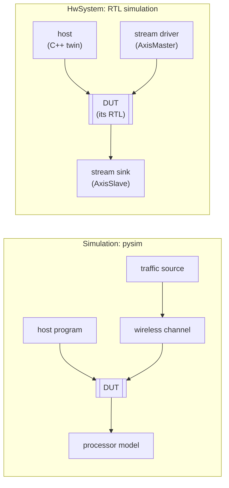
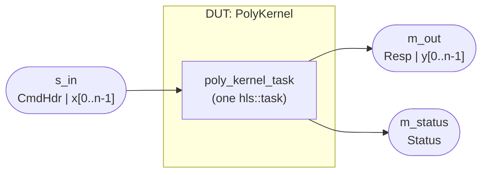

# The DUT and two levels of simulation

The DUT -- the design under test -- is what will be synthesized: the hardware. Synthesized hardware must
be **tested**, and Waveflow offers two modes. Both put the DUT in a simulation; they differ in what may
sit around it.



- **pysim** runs the DUT in a **[`Simulation`](../sim/index.md)**: a discrete-event simulation of any
  collection of `SimObj`s. Beside the DUT there can be anything the question needs -- a host program, a
  wireless channel, a traffic source, a processor model. It is fast, its timing is a model, and it is
  where a design is explored and evaluated as part of a larger system ([Simulating in Python](pysim.md)).
- **RTL simulation** runs the DUT in an **[`HwSystem(sim, dut)`](rtl.md#the-system)**: the same kind of
  simulation, with the DUT named, and everything else its **testbench**. The DUT's Verilog runs cycle by
  cycle under Vivado's simulator, and every testbench part runs as its C++ twin beside it
  ([Simulating at RTL](rtl.md)).

The rule between them is one line: **anything can join a `Simulation`; only what has an RTL twin can
join an `HwSystem`.** A host has a C++ twin, so it can drive the RTL; a wireless channel model has none,
so a study with one is a pysim study, and its RTL simulation draws the testbench where everything has
a twin. Here the DUT is a black box; the rest of this page is what goes inside it.

## Designing the DUT: the recipe

Designing the DUT means answering five questions before any module is written. They are the system's
design, and every later step follows from them.

1. **What it does** -- pinned as a golden model.
2. **Its boundary** -- where it meets everything else.
3. **Its modules** -- how the work is partitioned.
4. **The interfaces** between them.
5. **The messages** on each interface.

## Example: the polynomial

The running example is the [free-running polynomial](../../examples/stream_kernel/index.md). Its five
answers, in brief:

1. **What it does:** for each command, evaluate $y = c_0 + c_1 x + c_2 x^2 + c_3 x^3$ on its float32
   samples, in Horner order, and report how the command ended.
2. **Its boundary:** three streams -- `s_in` takes a command and its samples, `m_out` gives the results,
   `m_status` gives one status per command.
3. **Its modules:** one -- `PolyKernel`, a leaf with one `run_iter`, which becomes one task. The work is
   one stage, so there is nothing to split.
4. **The interfaces:** the three streams, each framed (TLAST ends each message).
5. **The messages:** `CmdHdr(tx_id, nsamp, c0..c3)` and the samples in; `Resp(tx_id, nsamp)` and the
   results out; `Status(tx_id, status)`, with `status` `OK` or `TLAST_EARLY`.



Each answer in turn, below.

## What it does: the golden first

Write the operation as **pure functions**, independent of any module and bit-exact: every rounding,
every saturation, the order of every sum. The polynomial's is Horner's rule in float32, in the order the
C++ uses, so the hardware matches it bit for bit:

```python
def poly_eval(coeffs, x):                  # c0 + c1 x + c2 x^2 + c3 x^3, float32, Horner order
    ...
```

Then the scenarios, as **intents** -- what each command is for -- and the expected outputs **computed
from the intents**, never from the stimulus:

```python
cmds = [Cmd(tx_id=1, samples=x1, coeffs=c1), Cmd(tx_id=2, samples=x2, coeffs=c2, sent=5), ...]
s_in = stimulus(cmds)                      # what the DUT is sent
want_out, want_status = expected(cmds)     # what it must answer, from the intents
```

A bug in `stimulus` cannot hide by being repeated in `expected`. The golden is what every later
simulation is checked against ([The polynomial's golden](../../examples/stream_kernel/golden.md)).

## Its boundary

The DUT's **ports** are where it meets the rest of the system: a stream from a source, a stream to a
sink, a bus a host reaches it by, a memory it reads. Draw them first, with what crosses each: the
polynomial has three -- `s_in` (commands and samples), `m_out` (results), `m_status` (one status per
command).

Everything outside the boundary is the **testbench** at RTL and the world in pysim. That split is a
build choice, not a property of the design: any module inside can later be the DUT of its own harness
([the cut](pysim.md#the-cut)).

## Its modules

A module is a [`HwModule`](../flows/modules.md): typed ports and a behavior. The modules of a free-running
design are [`FreeRunMod`](../flows/modules.md)s, and each takes one of two shapes -- **a body or
children, never both**:

- **A leaf** implements `run_iter`: **one firing**, the work on one message. The runtime fires it again
  for the next; there is no "before the loop", and state that must outlive a firing is declared
  ([`add_state`](../memory/hwstate.md)). At RTL it is one `hls::task`.
- **A composite** has children (`add_comp`) wired by internal interfaces (`add_if`), and no body. Each
  child becomes its own task, each internal interface a FIFO, and the stages **run concurrently**.

**Split into stages when the work has parts that should overlap** -- a load, a compute and a store
pipelined across jobs, or two computations at different rates. One stage of work is a leaf.

**On a bus, a kernel is a device**: the kernel with the memory-mapped views a host reaches it through,
built from what its class declares (`mm_views`, [`build_mm_device`](../interface/axi_mm/slave.md)).

Under every free-running design sits one rule: **a module's own logic reads and writes only streams**;
memory, bus masters and interrupts reach it through adaptors ([Stream patterns](streams.md)).

## The interfaces

Each link between modules, or between the DUT and its testbench, is one typed interface:

| the link | interface | reference |
|---|---|---|
| a stream of messages | `StreamIF` (framed, with TLAST, for messages) | [Streams](../interface/primitive/stream.md) |
| a stream whose producer must not overrun a far queue | `CreditStreamIF` | [Credit stream](../interface/derived/credit_stream.md) |
| a host or another master reaching a kernel | a memory-mapped device and the AXI crossbar | [AXI-MM slave](../interface/axi_mm/slave.md) |
| a kernel reading or writing memory | `MemRStream` / `MemWStream` on `m_axi` | [AXI-MM master](../interface/axi_mm/master.md) |
| a memory shared by address | `BramIF` | [BRAM](../interface/primitive/bram.md) |
| "something is ready" to a host | `IrqIF` | [Interrupts](../interface/axi_mm/slave.md#interrupts) |

## The messages

On each interface, the messages and their fields, as [schemas](../schema/index.md) -- one class per
message, and every word packed by generated code on both sides:

```python
class CmdHdr(DataList):
    elements = {"tx_id": U16, "nsamp": U16, "coeffs": CoeffArray}

class Resp(DataList):                      # heads the results on m_out
    elements = {"tx_id": U16, "nsamp": U16}

class Status(DataList):                    # one per command on m_status
    elements = {"tx_id": U16, "status": StatusCodeField}
```

The same classes generate the C++ structs the HLS body reads and writes, so the two sides agree on
every bit by construction. Several kinds of message on one stream are a
[tagged union](../schema/python/tagged_union.md); validate each schema as it is written
(`waveflow_validate_schema` for an assistant).

## Steps up

**A pipeline: [block_eq](../../examples/block_eq/index.md).** A block equalizer computes a gain per row
from a channel estimate, then applies it to that row's samples -- two computations at different rates.
The DUT is a composite of three: a framework [`StreamBroadcast`](../streams/broadcast.md) giving each
stage its own copy of the input, a `gain` stage, and an `apply` stage, joined by internal framed
streams whose depths are sized against what can pile up in them.

**A bus system: [markov](../../examples/markov/index.md).** A generator draws random numbers and a chain
walks a Markov chain on them, writing its states to a shared memory a host reads back. The DUT is two
devices -- each kernel with the queue views the host and the other kernel reach it by -- an on-chip
memory, and the crossbar between them; the host is the testbench. The link between the kernels is a
credit stream, because the generator must not overrun the chain's queue across the bus.

Next: [Stream patterns](streams.md) -- how the modules talk.
