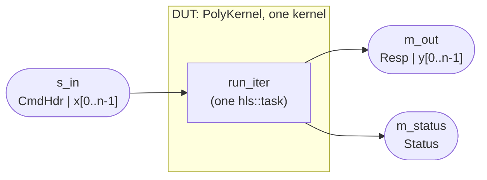

# Designing the DUT

The DUT is the hardware being built. What it is made of -- kernels, the adaptors around them, devices,
memories -- is [Kernels](kernels.md) and [Devices and the DUT](devices.md); this page is how to design
one, on the running example.

## The recipe

Designing the DUT means answering five questions before any code is written. They are the hardware's
design, and every later step follows from them.

1. **What it does** -- pinned as a golden.
2. **Its kernels** -- how the work is split.
3. **What each kernel talks to** -- its streams, and an adaptor for anything that is not a stream.
4. **The messages** on each stream.
5. **One firing** -- what each leaf kernel's `run_iter` reads, computes and writes.

## Example: the polynomial

The running example is the [free-running polynomial](../../examples/stream_kernel/index.md). Its five
answers, in brief:

1. **What it does:** for each command, evaluate $y = c_0 + c_1 x + c_2 x^2 + c_3 x^3$ on its float32
   samples, in Horner order, and report how the command ended.
2. **Its kernels:** one, `PolyKernel`, a leaf. The work is one stage, so there is nothing to split.
3. **What it talks to:** only streams -- no bus, no memory -- so it needs **no adaptor**: the DUT is one
   device, and the device is the kernel itself. Three streams: `s_in` brings a command and its samples, `m_out` takes the results,
   `m_status` takes one status per command.
4. **The messages:** `CmdHdr(tx_id, nsamp, c0..c3)` then the samples on `s_in`; `Resp(tx_id, nsamp)`
   then the results on `m_out`; `Status(tx_id, status)` on `m_status`, with `status` `OK` or
   `TLAST_EARLY`.
5. **One firing:** read a command, answer its header, read its samples, evaluate the golden's
   polynomial on them, write the results, write the status -- and on a short burst, stop.



Each answer in turn, below.

## What it does: the golden first

Write the operation as **pure functions**, independent of any kernel and bit-exact: every rounding,
every saturation, the order of every sum. The polynomial's is Horner's rule in float32, in the order the
C++ uses, so the hardware matches it bit for bit:

```python
def poly_eval(coeffs, x):                  # c0 + c1 x + c2 x^2 + c3 x^3, float32, Horner order
    ...
```

Then the scenarios, as **intents** -- what each command is for -- and the expected outputs **computed
from the intents**, never from the stimulus:

```python
cmds = [Cmd(tx_id=1, samples=x1, coeffs=c1), Cmd(tx_id=2, samples=x2, coeffs=c2, sent=5), ...]
s_in = stimulus(cmds)                      # what the DUT is sent
want_out, want_status = expected(cmds)     # what it must answer, from the intents
```

A bug in `stimulus` cannot hide by being repeated in `expected`. The golden is what every later
simulation is checked against ([The polynomial's golden](../../examples/stream_kernel/golden.md)), and
the kernel's `run_iter` calls the same `poly_eval`.

## Its kernels

Split the work into kernels where it has **parts that should overlap**: a load, a compute and a store
pipelined across jobs, or two computations at different rates. Those parts are child kernels of a
**composite**, and they run concurrently. Work that is one stage is one **leaf**
([Kernels](kernels.md#what-a-kernel-is)).

The polynomial is one stage: read, evaluate, write. So the DUT is one leaf kernel.

## What each kernel talks to

For each kernel, list everything it talks to, and give each one its stream from the table in
[Kernels](kernels.md#the-stream-for-each-thing-a-kernel-talks-to): another kernel is a framed stream; a host on the bus is a queue
or a register bank, behind a **slave adaptor**; memory is a command to a memory reader or writer. The
kernels and the adaptors they need are a **device** ([Devices and the DUT](devices.md)); the views a bus
needs are declared on the kernel's class (`mm_views`).

The polynomial talks only to streams, so it needs no adaptor:

| stream | direction | carries |
|---|---|---|
| `s_in` | in | a command, then its samples |
| `m_out` | out | the results' header, then the results |
| `m_status` | out | one status per command |

All three are framed: TLAST closes each message. What sits at their other ends is not part of the
design: the testbench at RTL (a stream driver and two sinks), anything at all in pysim. Put the same
kernel on a bus and its device gains a slave adaptor, its `run_iter` unchanged
([The polynomial on a bus](../../examples/stream_kernel_mm/index.md)).

## The messages

On each stream, the messages and their fields, as [schemas](../schema/index.md) -- one class per
message, and every word packed by generated code on both sides:

```python
class CmdHdr(DataList):
    elements = {"tx_id": U16, "nsamp": U16, "coeffs": CoeffArray}

class Resp(DataList):                      # heads the results on m_out
    elements = {"tx_id": U16, "nsamp": U16}

class Status(DataList):                    # one per command on m_status
    elements = {"tx_id": U16, "status": StatusCodeField}
```

The same classes generate the C++ structs the HLS body reads and writes, so the two sides agree on
every bit by construction. Several kinds of message on one stream are a
[tagged union](../schema/python/tagged_union.md); validate each schema as it is written
(`waveflow_validate_schema` for an assistant). How a command and its answer are laid out across the
streams is [Command-response](command_response.md).

## One firing

A leaf's `run_iter` is **one firing**: the work on one message. The runtime fires it again for the next;
there is no "before the loop", and state that must outlive a firing is declared
([`add_state`](../memory/hwstate.md)). The polynomial's firing, in order:

1. read the command, `CmdHdr`, from `s_in`;
2. write the results' header, `Resp(tx_id, nsamp)`, to `m_out`;
3. read the samples from `s_in` -- fewer than `nsamp` if the burst ended early;
4. evaluate the golden's `poly_eval` on them, and write the results to `m_out`;
5. write `Status(tx_id, OK)` to `m_status`, or `TLAST_EARLY` if the samples were short -- and then
   stop taking input, since an error is fatal.

The firing is written in Python, and again, to read the same way, as the kernel's HLS body
([Defining the kernel in Python and HLS](hwmodule.md)).

## Steps up

**A pipeline: [block_eq](../../examples/block_eq/index.md).** A block equalizer computes a gain per row
from a channel estimate, then applies it to that row's samples -- two computations at different rates.
The DUT is one device, a composite kernel of three children: a framework
[`StreamBroadcast`](../streams/broadcast.md) giving each stage its own copy of the input, a `gain`
stage, and an `apply` stage, joined by internal framed streams whose depths are sized against what can
pile up in them. Still only streams: no adaptor.

**A bus system: [markov](../../examples/markov/index.md).** A generator draws random numbers and a chain
walks a Markov chain on them, writing its states to a shared memory a host reads back. The DUT is two
devices -- each kernel with the queue views the host and the other kernel reach it by -- an on-chip
memory, and the crossbar between them; the host is the testbench. The stream between the kernels is a
credit stream, because the generator must not overrun the chain's queue across the bus.

Next: [Stream patterns](streams.md) -- more on how kernels talk.
