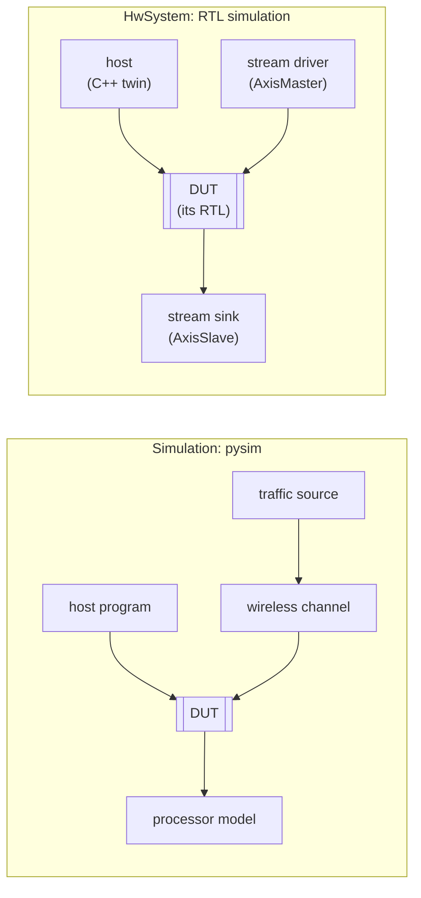

# Waveflow Architecture

## What is Waveflow?

Waveflow is a Python package for designing hardware and simulating it in the environment it will work
in. Its first target is hardware for wireless communications and sensing. The hardware being built is
the **DUT**. The environment is several things running at once: the DUT itself -- kernels and memories
joined by streams and interconnects -- and the world around it, such as host processors, peripherals,
wireless channels and RF components.

The simulations answer three questions about the hardware:

- **Accuracy and correctness.** Are the computations right, and how accurate are they? For example,
  how does the number of iterations, or the bit-width of a fixed-point approximation, change the
  result?
- **Timing.** How fast is it? The system's throughput, its latency, how often a deadline is missed.
- **Cost.** What does the hardware take? Resources (LUTs, DSPs, BRAM), estimated from calibrated
  models in Python and measured by synthesis; energy, for the processor model.

In most designs accuracy, throughput and cost trade off against one another. Waveflow is built to
explore that trade-off quickly, by hand or with an agent searching the design space.

This page is **what** is built and simulated. How to build it, step by step, is the
[Flow Overview](flow.md). Every term used here is defined in the [Glossary](glossary.md).

## Three levels of simulation {#three-levels}

Waveflow simulates the DUT at three levels:

| level | what runs | what it tells you |
|---|---|---|
| **golden** | the operation as pure, bit-exact Python functions: no time, no modules | functional accuracy, fast enough to search a design space at scale; the reference the other two levels are checked against |
| **pysim** | the DUT's modules in Python, timed, in a [`Simulation`](pysim.md) with its environment | throughput, latency, missed deadlines; whether the modules work together, without a protocol error or a deadlock; cost from calibrated models |
| **RTL** | the DUT's Verilog in an [`HwSystem`](rtl.md#the-system), cycle by cycle, its testbench as C++ twins | whether the hardware does what the Python does; exact cycle counts; cost measured by synthesis |

There are **two descriptions of the DUT, not three.** The golden and pysim share the first: a
kernel's Python behavior (`run_iter`) **calls** the golden's functions, so pysim computes exactly what
the golden does and adds time. The second is each kernel's **HLS body**, written separately in C++; the
RTL simulation runs it, and its outputs are compared with pysim's word for word. In the running example,
the golden's `poly_eval` is what
[`PolyKernel.run_iter`](../../../examples/stream_kernel/stream_kernel.py) evaluates, and the HLS body is
written to read the same way.

The golden takes three forms, all from the same functions: the **functions** themselves (what it
does, [Designing the DUT](dut.md#what-it-does-the-golden-first)); a module's **`golden(kind)`**, the
bursts each output must record for a workload, which its harness checks pysim against
([verification](verification.md)); and a design's **`golden(params, workload)`** for design-space
search, the accuracy metrics of an untimed run ([DSE context](../dse/context.md)).

## Around the DUT: pysim and RTL {#around-the-dut}

The two simulated levels hold the same DUT. What changes is the layer around it:

- **In pysim** the outer layer is a [`Simulation`](pysim.md): a discrete-event simulation of
  `SimObj`s. The DUT is one of them (every module is a `SimObj`), and the rest is anything the question
  needs -- a host program, a wireless channel, a traffic source, a processor model -- at whatever level of
  detail. **Anything can join a `Simulation`.**
- **At RTL** the outer layer is an [`HwSystem(sim, dut)`](rtl.md#the-system): a simulation with one
  module named the DUT. Everything else is its **testbench**, derived, never listed: hosts, stream
  drivers and sinks, memory models, each running as a C++ twin beside the DUT's Verilog. **Only what has
  an RTL twin can join an `HwSystem`.** A wireless channel model has none, so a study with one is a
  pysim study, and its RTL simulation draws the testbench where everything has a twin
  ([Simulating at RTL](rtl.md)).

## Inside the DUT: the same tree at both levels {#the-dut-tree}

![The DUT alone, in a solid box, with a crossbar (purple, vendor IP) on its left reached by the host from outside. A device, in a dashed box, holds a front with views (green, Waveflow provides it) and kernel A (blue, you write it: run_iter and its HLS body), joined by streams; an interrupt runs from the views out of the DUT to the host. Kernel A sends commands on a stream to kernel C, inside a composite (dash-dot box) with a memory reader, MemRStream, and a memory writer, MemWStream (both green), each on the crossbar through m_axi. A memory, in a dashed box, holds a front with a window and the RAM (green), on the crossbar. A legend: blue, you write it, the Python model and the HLS body; green, Waveflow provides it; purple, vendor IP generated from the address map; dashed, a device or memory, one sub-top and one IP; dash-dot, a composite, a task per child.](../flows/figures/dut_tree.svg)

The DUT is one module, or a `DutTop` grouping several with the interfaces between them. Its parts:

- **A kernel** is a free-running leaf: one `run_iter` in Python, one HLS body, one `hls::task`.
- **A composite** has children wired by internal interfaces and no body of its own; the children run
  concurrently, a task each.
- **A device** is a kernel or composite with its **slave adaptor**: a **front**, the one part that
  speaks AXI, and **views** behind it (queues, a register bank, a BRAM window) that turn bus accesses
  into streams. A device is one sub-top in the Verilog and one IP when packaged.
- **Memory readers and writers** (`MemRStream`, `MemWStream`) move data between memory and streams
  through `m_axi`.
- **The crossbar** joins devices and memories by an address map, and **memories** hold the data.

Under every part sits one rule: **a module's own logic reads and writes only streams.** A bus, a memory
and an interrupt reach it through **adaptors** -- a slave adaptor's views on the bus side, memory readers
and writers on the master side -- outside its logic ([Stream patterns](streams.md)). The **interfaces**
between modules are typed connections (streams, credit streams, BRAM, interrupts), and the **messages**
on them are [schemas](../schema/index.md).

The DUT is a choice made per run, not a property of a class: **any module can be the DUT of its own
harness**, `harness(Module, workload=...)`, with a generated stand-in at each port. Each module is
simulated alone, at both levels, before the whole ([The cut](pysim.md#the-cut)).

## What you write, and what Waveflow provides {#what-you-write}

| the piece | you write | Waveflow provides |
|---|---|---|
| the messages | the schema classes | the C++ structs, every word packed and unpacked, the array utilities |
| the golden | pure, bit-exact functions | -- |
| a kernel | its **Python model**, `run_iter` (one firing, calling the golden), **and its HLS body**, the same behavior in C++. The two must agree; the RTL comparison checks it | the HLS top around the body, its csynth script |
| a composite | its children and their wiring (`add_comp`, `add_if`) | a task per child, a FIFO per internal interface |
| a device | the views on the kernel's class (`mm_views`) | the views and the front (framework RTL), the address map, the crossbar |
| memory access | the commands the logic issues | `MemRStream` / `MemWStream`, the memory models |
| the testbench | each module's `workload(kind)` and `golden(kind)`; a host's threads, twice: in Python, and in C++ for RTL ([Software threads](../build/sw_threads.md)) | the stand-ins and their C++ twins, the host's generated endpoints, the Verilog top, the build steps |

**The HLS body is needed only for the hardware levels**: RTL simulation, and the timing and resources
measured from synthesis ([Timing and resources](calibration.md)). A study that stays in the golden and
pysim needs only Python. A kernel's two copies are written to read the same way
([Defining the kernel in Python and HLS](hwmodule.md)).

Next: [Flow Overview](flow.md) -- how a design is built and checked, step by step. Every term
on this page, with its class and the page that defines it, is in the [Glossary](glossary.md).
