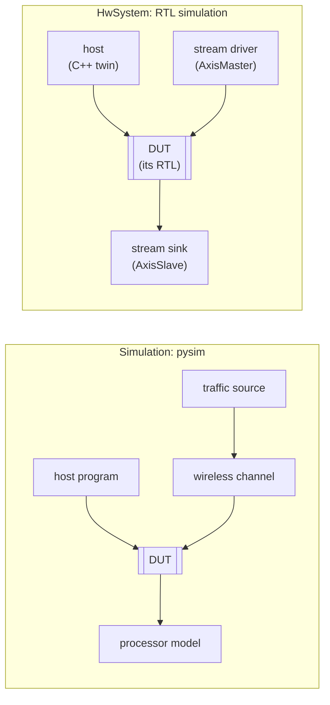

# Waveflow Architecture

## What is Waveflow?

Waveflow is a Python package for designing hardware and simulating it in the environment it will work
in. Its first target is hardware for wireless communications and sensing. The hardware being built is
the **DUT**. The environment is several things running at once: the DUT itself -- kernels and memories
joined by streams and interconnects -- and the world around it, such as host processors, peripherals,
wireless channels and RF components.

The simulations answer three questions about the hardware:

- **Accuracy and correctness.** Are the computations right, and how accurate are they? For example,
  how does the number of iterations, or the bit-width of a fixed-point approximation, change the
  result?
- **Timing.** How fast is it? The system's throughput, its latency, how often a deadline is missed.
- **Cost.** What does the hardware take? Resources (LUTs, DSPs, BRAM), estimated from calibrated
  models in Python and measured by synthesis; energy, for the processor model.

In most designs accuracy, throughput and cost trade off against one another. Waveflow is built to
explore that trade-off quickly, by hand or with an agent searching the design space.

This page is **what** is built and simulated. How to build it, step by step, is the
[Flow Overview](flow.md). Every term used here is defined in the [Glossary](glossary.md).

## Three levels of simulation {#three-levels}

Waveflow simulates the DUT at three levels:

| level | what runs | what it tells you |
|---|---|---|
| **golden** | the operation as pure, bit-exact Python functions: no time, no modules | functional accuracy, fast enough to search a design space at scale; the reference the other two levels are checked against |
| **pysim** | the DUT's modules in Python, timed, in a [`Simulation`](pysim.md) with its environment | throughput, latency, missed deadlines; whether the modules work together, without a protocol error or a deadlock; cost from calibrated models |
| **RTL** | the DUT's Verilog in an [`HwSystem`](rtl.md#the-system), cycle by cycle, its testbench as C++ twins | whether the hardware does what the Python does; exact cycle counts; cost measured by synthesis |

There are **two descriptions of the DUT, not three.** The golden and pysim share the first: a
kernel's Python behavior (`run_iter`) **calls** the golden's functions, so pysim computes exactly what
the golden does and adds time. The second is each kernel's **HLS body**, written separately in C++; the
RTL simulation runs it, and its outputs are compared with pysim's word for word. In the running example,
the golden's `poly_eval` is what
[`PolyKernel.run_iter`](../../../examples/stream_kernel/stream_kernel.py) evaluates, and the HLS body is
written to read the same way.

The golden takes three forms, all from the same functions: the **functions** themselves (what it
does, [Designing the DUT](dut.md#what-it-does-the-golden-first)); a module's **`golden(kind)`**, the
bursts each output must record for a workload, which its harness checks pysim against
([verification](verification.md)); and a design's **`golden(params, workload)`** for design-space
search, the accuracy metrics of an untimed run ([DSE context](../dse/context.md)).

## Around the DUT: pysim and RTL {#around-the-dut}

The two simulated levels hold the same DUT. What changes is the layer around it:

- **In pysim** the outer layer is a [`Simulation`](pysim.md): a discrete-event simulation of
  `SimObj`s. The DUT is one of them (every module is a `SimObj`), and the rest is anything the question
  needs -- a host program, a wireless channel, a traffic source, a processor model -- at whatever level of
  detail. **Anything can join a `Simulation`.**
- **At RTL** the outer layer is an [`HwSystem(sim, dut)`](rtl.md#the-system): a simulation with one
  module named the DUT. Everything else is its **testbench**, derived, never listed: hosts, stream
  drivers and sinks, memory models, each running as a C++ twin beside the DUT's Verilog. **Only what has
  an RTL twin can join an `HwSystem`.** A wireless channel model has none, so a study with one is a
  pysim study, and its RTL simulation draws the testbench where everything has a twin
  ([Simulating at RTL](rtl.md)).

## Inside the DUT {#the-dut-tree}

The DUT is the same tree at both simulated levels. Two pages describe it:

- **[Kernels](kernels.md)** do the work. A kernel is a `FreeRunMod` whose interfaces are all streams --
  a leaf with its own `run_iter`, or a composite of child kernels -- yours or the library's.
- **[Devices and the DUT](devices.md)** is everything else. An **adaptor** joins streams to something
  that is not a stream: memory through `m_axi`, a bus through a slave adaptor's front and views. A
  **device** is kernels plus their adaptors, built as an HLS top and RTL in one sub-top, one IP. The DUT
  is devices, memories and the interconnect. That page also lists what you write and what Waveflow
  provides.

Next: [Kernels](kernels.md) -- what does the work, and how it talks; then [Devices and the DUT](devices.md),
[Command-response](command_response.md), and the [Flow Overview](flow.md). Every term
on this page, with its class and the page that defines it, is in the [Glossary](glossary.md).
