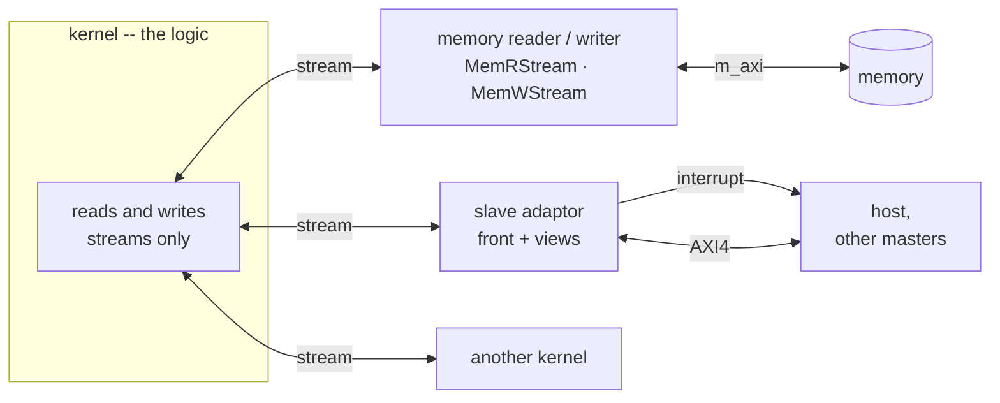

# Kernels

The work a Waveflow design does is done by **kernels**. This page is what a kernel is, how kernels
nest, and how they talk -- on streams, and only on streams. How kernels meet memory, a bus and the rest
of the world -- through adaptors, in devices -- is [Devices and the DUT](devices.md).

## What a kernel is

> A **kernel** is a [`FreeRunMod`](../flows/modules.md) whose interfaces are all streams: a component of
> the hardware, described in Python by its operation.

You write a kernel, or take one from Waveflow's library: the stream blocks
([`StreamBroadcast`](../streams/broadcast.md)), the systolic matrix multiply, the vector unit, the FFT.

A kernel is **free-running**: no host starts it. It runs forever, waits on its input streams, and acts on
each message that arrives -- a command, a burst of samples, a setting. Each action is one **firing**.

Kernels are **hierarchical**. A kernel is one of two shapes, never both:

- **A leaf** has its own behavior, `run_iter`: one firing, the work on one message. It becomes one
  `hls::task`.
- **A composite** has child kernels (`add_comp`) wired by streams (`add_if`), and no body of its own.
  The children run concurrently, a task each. Its children are kernels, so its interfaces are streams
  too.

So a kernel can be a tree of kernels. block_eq's equalizer is a composite of three:

```
block_eq                    a composite kernel: one HLS top, three tasks
├── broadcast               a library kernel (StreamBroadcast): a copy of the input for each stage
├── gain                    a leaf: run_iter, one hls::task
└── apply                   a leaf: run_iter, one hls::task
```

Either shape can be synthesized as an HLS top: block_eq is one, and each stage is also a top of its
own, run alone in its harness ([block_eq](../../examples/block_eq/index.md)).

A composite's children need not form a line. One child can serve several others, and a child's output
can come back to an earlier child -- a cycle inside the composite. That is how one expensive kernel is
shared: [Sharing a kernel](shared_kernels.md).

Three kinds of module are not kernels:

- **An adaptor** -- a module with streams on one side and something that is not a stream on the other:
  a memory reader or writer (`MemRStream`, `MemWStream`, on `m_axi`), a slave adaptor on the bus. A
  composite with an adaptor among its children is not a kernel either: kernels and their adaptors
  together are a **device** ([Devices and the DUT](devices.md)).

- **`HostActivated`** -- a kernel a host *launches* (`ap_start` / `ap_done`) and that runs once per
  launch. Use it only when the design asks for a launch ([Sequential flow](../flows/sequential.md)).
- **A plain `HwModule`** -- a model Waveflow simulates but never builds: a channel, a converter, a memory
  model. It belongs to the world around the DUT.

A leaf kernel is written twice, as a Python `run_iter` and as an HLS body that must agree
([Defining the kernel in Python and HLS](hwmodule.md)); a composite is written once, as its children and
their wiring.

## A kernel's interfaces are streams

Under every kernel sits one rule:

> **A kernel reads and writes only streams. Anything that is not a stream -- memory, a bus, an
> interrupt -- reaches it through an adaptor.**

A kernel that reads memory has no `m_axi` in its logic: it sends a read command on a stream to a memory
reader and gets the data back on another stream. A kernel a host must reach exposes no registers: a
slave adaptor turns the host's bus writes into messages on a stream it reads. The kernel is the
**logic**; the adaptors are the **transport**.



A kernel declares the ends of its streams in `__post_init__`: an **input stream** it reads (named
`s_...`) or an **output stream** it writes (`m_...`).

## The stream for each thing a kernel talks to

Waveflow supports a fixed set of streams, one for each kind of thing a kernel talks to:

| the kernel talks to                                                         | its stream                                                                                                                            | what is outside the kernel                                                                  |
| --------------------------------------------------------------------------- | ------------------------------------------------------------------------------------------------------------------------------------- | ------------------------------------------------------------------------------------------- |
| another kernel                                                              | a framed stream: [`FramedStreamIFSlave` / `FramedStreamIFMaster`](../interface/primitive/stream.md), TLAST closing each message    | nothing; inside a composite, an internal `StreamIF` of a stated depth                     |
| a host or another bus master that sends it work or data                     | an input stream                                                                                                                       | a **queue in** view of its slave adaptor ([views](../interface/axi_mm/slave_views.md)) |
| a host that takes its results over the bus                                  | an output stream; a queue out drops TLAST, so the host sizes what it reads from a header or a fixed-size message                      | a **queue out** view, and an interrupt when results are waiting                       |
| a host that sets something at any time                                      | an input stream: one message per commit of the settings                                                                               | a **register bank** view                                                              |
| a host that reads a status at any time                                      | an output stream: the register bank keeps the latest                                                                                  | the same register bank                                                                      |
| memory, to read                                                             | a command on an output stream (`MemRCmd`: address, length), the data back on an input stream                                        | a memory reader, [`MemRStream`](../interface/axi_mm/master.md): an adaptor in the same device                                            |
| memory, to write                                                            | a command (`MemWCmd`) and the data on output streams; bursts it asked to have echoed come back on `m_done` when the write is done | a memory writer, [`MemWStream`](../interface/axi_mm/master.md): an adaptor in the same device                                            |
| a queue across the bus it must not overrun                                  | a [credit stream](../interface/derived/credit_stream.md) (`CreditStreamIF`): writes wait on credit                                   | a **credit** view at the far end                                                      |
| a consumer only it can learn an outcome from (a deadline missed downstream) | an [acked stream](../interface/derived/acked_stream.md) (`AckedStreamIF`): the stream, and a status back for each message            | --                                                                                          |

**The one exception is storage.** A [`BramIF`](../interface/primitive/bram.md) is a memory the kernel
reads and writes by address, and a kernel's own [`HwState`](../memory/hwstate.md) is plain arrays.
Neither is an event. What tells a kernel that the storage is *ready* is still a stream message: in
[bram_access](../../examples/bram_access/index.md) two tasks share one memory, and which one touches it,
and when, arrives as commands on streams. Interrupts never reach a kernel at all: a view raises them
toward the host.

## Every stream is typed

Every message on every stream is a [schema](../schema/index.md): its fields declared once in Python,
and every word packed and unpacked by generated code on both sides.

- **A message is a burst**, closed by TLAST. A header and its data are two bursts: the reader reads the
  header, learns `n`, then reads the data.
- **A message is read and written by its schema**: `get_schema(CmdHdr)`, `get_array(Elem, n)`,
  `write(msg)`, `write_array(...)` in Python; the generated readers and writers in C++. Never packed or
  unpacked by hand.
- **One Python `write` is one burst.** In the HLS body each message goes out as it is made, with TLAST on
  its last word.
- **A burst that ends early is short, not padded.** `get_array(T, n)` returns the elements that arrived;
  a short data burst is how a sender's error announces itself. A schema cannot arrive in part.
- **Several elements can share a word**, two 16-bit samples in a 32-bit word: the generated lane
  routines of the element's schema pack and unpack them ([Stream patterns](streams.md#words-and-lanes)).

## Read in the order written

A kernel reads another's streams **in the order the other writes them**, or buffers a whole job. A
reader that blocks on a status before reading the results leaves the results stream full; the writer
blocks, and the status never comes. Between two kernels, **a write and then a blocking read on two
different streams deadlocks** when the other side does the same in the other order: check with a
non-blocking read instead.

Where a kernel must not wait -- a setting that may or may not have changed -- it checks without
blocking, and the order of its checks **is** its priority, the same in Python and in HLS.

A deadlock in simulation looks like success: everything simply stops. So every test asserts **counts**:
bursts recorded, statuses written, jobs answered ([Functional verification](verification.md)).

## Why streams only

- **One event model.** Every event a kernel takes part in is a stream message: it arrives once, in
  order, and the kernel either waits for it or checks for it and moves on. Without the rule a kernel
  faces a register that changed, a FIFO that filled and a memory that was written -- three kinds of
  event with no defined order between them.
- **Logic decoupled from transport.** The same kernel takes its commands from another kernel, from a
  host's queue over the bus, or from a testbench: the polynomial runs unchanged in its harness and
  [on a bus](../../examples/stream_kernel_mm/index.md). Contention for a shared memory port is an arbiter
  over command streams, written once. Hand-written RTL stays in the adaptors, at the edge.
- **The cut falls on streams.** Any kernel can be the DUT of its own harness, because what surrounds it
  is always streams -- what both simulations model best.

Each section here is the short form. The detail -- bursts and lanes, the read order, why the rule
holds and where it stops, and what goes between kernels (stream blocks, internal stream depths and
widths, a token per job through a pipeline, credit) -- is [Stream patterns](streams.md).

Next: [Devices and the DUT](devices.md) -- adaptors, devices, and how they become hardware.
