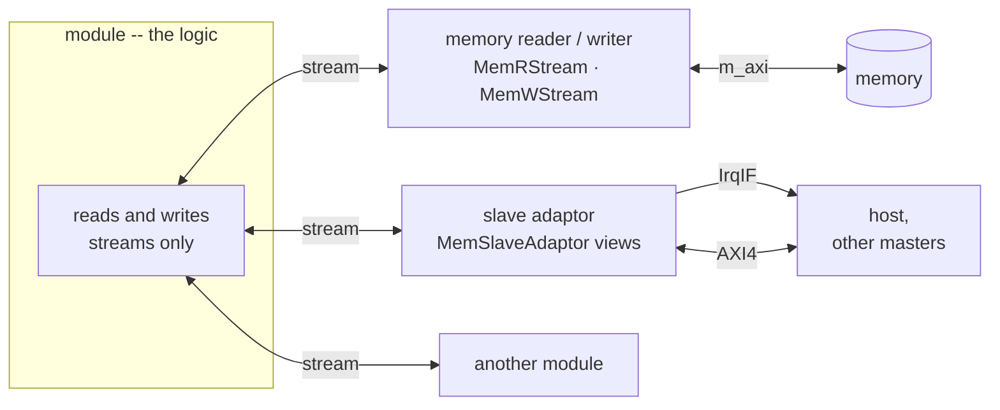

# Stream patterns

The modules of a free-running design talk on **streams**. This page is how: what a message on a stream
is, how its words are packed, the order things must be read in, the rule that keeps every module's logic
on streams, and the pieces that go between kernels.

## A message is a burst

A stream carries **words**; a **message** is a burst of them, closed by **TLAST**. The polynomial's
ports are framed -- they carry TLAST at RTL -- because its protocol is made of messages:

```python
self.s_in = FramedStreamIFSlave(name=f"{self.name}_s_in", sim=self.sim, bitwidth=W)
self.m_out = FramedStreamIFMaster(name=f"{self.name}_m_out", sim=self.sim, bitwidth=W)
```

```text
s_in  : CmdHdr(tx_id, nsamp, c0..c3) | x[0] .. x[nsamp-1]     TLAST on the header, and on the samples
m_out : Resp(tx_id, nsamp)           | y[0] .. y[nsamp-1]     TLAST on the header, and on the results
```

- **A header and its data are two bursts.** The reader reads the header, learns `n`, then reads the
  data. A short data burst -- TLAST before `n` -- is how a sender's error announces itself.
- **One Python `write` is one burst.** A burst of several messages is collected and written once; there
  is no writing a burst in pieces, because that would invite serializing by hand. In the HLS body each
  message goes out as it is made, `streamutils::write_msg(msg, s, last)`, with TLAST on the last.
- **A message is read with its schema**, `get_schema(CmdHdr)` in Python and the generated
  `read_axi4_stream` in C++ -- never unpacked by hand.
- **A burst that ends early is short, not padded.** `get_array(T, n)` on a burst whose TLAST came early
  returns the elements whose words arrived -- every lane of every arrived word, so at several elements a
  word a multiple of that count, capped at `n` -- and the body reads how many from the array
  (`len(x.val)`). A schema cannot arrive in part: a short `get_schema` raises.

## Words and lanes

A word carries `PF = WORD_BW / element_bits` elements -- two 16-bit samples in a 32-bit word, four
float32s in 128 bits. The body loops over **lanes**: one word per iteration with its lanes computed in
parallel, or one element per iteration reading a word every `PF`. The words are packed and unpacked by
the **generated lane routines** of the element's schema (`<elem>_array_utils::read_boundary_lane` /
`write_boundary_lane`), never by hand -- the routines know the layout and TLAST, the body does not.
How to shape that loop is [Design patterns for loop optimization](../vectorization/hls/loop_optimization.md).

## Read in the order written

A reader takes a writer's streams **in the order the writer writes them**, or buffers a whole job. The
polynomial writes the header, the results, then the status: a reader that blocks on the status first
leaves the results stream full, the kernel blocks writing it, and the status never comes -- a deadlock.
The same holds between two kernels: **a write and then a blocking read on two different streams
deadlocks** when the other side does the same in the other order; check with `read_nb` instead.

A deadlock in simulation looks like success -- everything simply stops. So every gate asserts **counts**:
bursts recorded, statuses written, jobs answered ([Functional verification](verification.md)).

## Stream-only modules and adaptors

Under every free-running design sits one rule:

> **A module's own logic reads and writes only streams. Anything that is not a stream reaches it
> through an adaptor.**

A module that reads memory does not own an `m_axi` port in its body; it sends a read command on a
stream to a reader and gets the words back on another. A module a host must reach does not expose
registers; a slave adaptor turns the host's bus writes into messages on a stream the module reads. The
module is the *logic*; the adaptors are the *transport*.



| what the module needs | the adaptor | where it lives | why there |
|---|---|---|---|
| to read or write memory -- it *masters* the bus | [`MemRStream` / `MemWStream`](../interface/axi_mm/master.md): a command on a stream in, a burst on `m_axi` out | a kernel module, inside the Vitis kernel | Vitis HLS generates `m_axi` |
| to *be reached* by a host or another master | a [`MemSlaveAdaptor`](../interface/axi_mm/slave.md) of views -- queue in, queue out, register bank, BRAM window | an RTL module, beside the kernel | Vitis HLS cannot generate an AXI4-full slave |
| to tell a host something is ready | an [`IrqIF`](../interface/axi_mm/slave.md#interrupts), driven by a queue view's threshold -- the adaptor raises it, not the module | a wire out of the adaptor | the host waits on it instead of polling |

Where an adaptor lives is decided by what Vitis HLS can generate
([AXI-MM: what decides the realization](../interface/axi_mm/index.md#what-decides-the-realization-what-vitis-hls-can-generate)),
not by the module: from the inside, a reader and a slave adaptor look the same -- a stream.

### Why: one event model

Every event a module takes part in is a **stream message**. A message arrives once, in order, and the
module can either wait for it (a blocking read) or check for it and move on (`read_nb` / `empty()`).
That one mechanism covers both things a module does with events:

- **It responds to data.** The module's body is "read the next message, act on it" -- a
  [straight-line loop per message](../vectorization/hls/loop_optimization.md), the same shape whatever
  the message came from.
- **It decides which event comes first.** With several input streams, the order the body checks them
  *is* the priority -- explicit, in the code, and the same in Python and in HLS. The RF repeat player
  ([`rf_circ_play_task.h`](../../../waveflow/build/rf_circ_play_task.h)) checks for a replacement
  waveform first, without blocking, and only then drains a bounded number of transmit responses: a new
  waveform pre-empts the schedule, and a missing one never stalls it.

Take the rule away and the module faces a register that changed, a FIFO that filled and a memory that
was written -- three kinds of event with **no defined order between them**. The
[slave adaptor's ordering guarantee](../interface/axi_mm/slave.md#ordering) exists precisely to turn bus
accesses back into messages that have one. And the cut between pysim and RTL, or between the kernel and
a testbench model, falls on streams -- what both simulations model best.

### Why: logic decoupled from transport

An adaptor owns everything about *how* data moves and *who else* wants the same resource: the bus
protocol, bursts, address decode, arbitration of a shared port, interrupt thresholds. The module owns
none of it, so:

- **The module is reusable across transports.** The same body takes its commands from another module's
  stream, from a host's queue over AXI, or from a testbench -- the polynomial runs unchanged in its
  harness and [on a bus](../../examples/stream_kernel_mm/index.md).
- **Contention is solved once.** Several modules sharing one memory port is an arbiter over command
  streams ([why a streaming interface](../interface/axi_mm/master.md#why-a-streaming-interface-to-memory)),
  written and timed once.
- **Hand-written RTL stays at the edge.** The Verilog a design needs sits in the adaptors and memories;
  the modules stay HLS tasks.

### The precise rule: synchronization, not storage

> **Every synchronization a module sees is a stream message.**

Storage a module *computes against* is not synchronization. A [`BramIF`](../interface/primitive/bram.md)
port is read and written by address, and a module's own [`HwState`](../memory/hwstate.md) is plain
arrays -- neither carries an event. What tells a module that the storage is *ready* still does: in
[bram_access](../../examples/bram_access/index.md) the two tasks share one memory, but which task touches
it, and when, arrives as command messages on streams. A [credit](../interface/derived/credit_stream.md)
or [acked](../interface/derived/acked_stream.md) stream adds a channel the other way; both directions
are stream messages.

## Between kernels

A pipeline of kernels needs a few more rules, and a few framework pieces:

- **Stream blocks.** The pieces a stream-only design keeps needing between its own kernels are written
  once, in [Stream Blocks](../streams/index.md): [`StreamBroadcast`](../streams/broadcast.md) gives each
  of several stages its own copy of one stream. Its outputs move in lockstep, so **a stage that waits on
  another must first consume its own copy of anything queued ahead**.
- **An internal link's depth is explicit**, sized against what can pile up in it: a burst of results
  while the next stage is busy. block_eq's links are framed streams of depth 128
  ([block_eq's link depths](../../examples/block_eq/stages.md#link-depths)).
- **An internal link has its own width.** A link between two stages need not be the boundary's word:
  `StreamIF(bitwidth=LW, framed=True, depth=...)` is declared at `LW` in the generated top, beside
  `W`-bit boundary ports, and each stage's body sees `framed_word<LW>` on that port through
  `KernelTask(framed=...)`. A wide link carries a whole record a cycle -- a detection's index and peak
  with its lane flags -- where a boundary-width link would take several words.
- **Every stage gets a token per job.** In a free-running pipeline, a stage that consumes a job and
  emits nothing leaves the next stage waiting forever; if a job produces no output, forward something
  anyway. The command travels with the data, and the last stage answers.
- **Credit when blocking would stall something shared.** A producer that blocks on a full stream is
  fine between two kernels; across a bus, where a blocked write holds the crossbar, the producer waits on
  credit instead -- a [credit stream](../interface/derived/credit_stream.md), as markov's generator does.
  In the HLS body the chunk's writes are guarded on the credit wait
  ([the guard](../interface/axi_mm/credit_streams_hls.md#the-guard)).

Next: [Command-response](command_response.md) -- the protocol most designs speak on these streams.
