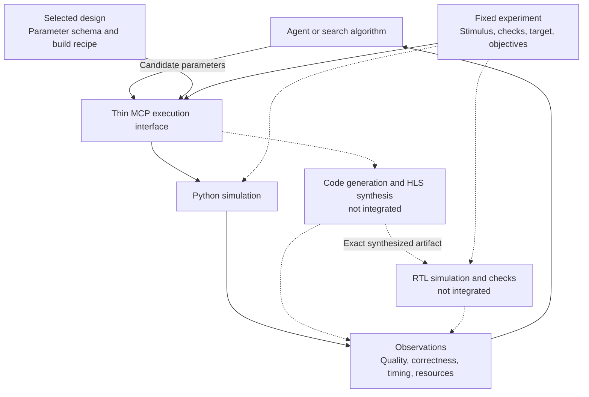

# Execution contract

The professor’s loop defines the interface; FIR illustrates it. This direction was
agreed on 2026-10-04; the earlier FIR-first plan is retained as historical context.

The host selects a registered design and fixes its test conditions. The caller can
choose candidate parameters and which operation to run, but cannot change the test
to make a candidate pass. Search and ranking remain outside the service.

FIR and MemCopy use this contract through CLI and MCP. Supporting another design
requires an adapter with legal parameters, a model and checks; arbitrary Python
is not automatically supported.

## Four operations

| Call | Current result | Hardware extension |
|---|---|---|
| `get_param_list()` | Names, descriptions, types, defaults, legal domains and coupling constraints; fixed conditions, metrics, stage availability/reasons and known cost estimates | Advertise hardware only when implemented |
| `pysim(params)` | Python metrics, checks, wall time and saved-file references | Unchanged |
| `synth(params)` | `unavailable`, saved as an attempt | Generated/synthesized artifact, HLS resource/timing estimates, duration and result reference |
| `rtlsim(synthesis_id)` | Rejects IDs without successful synthesis | Consume that exact successful artifact; return verification, observed latency/throughput, duration and trace/report references |

Code generation is part of synthesis, not another agent tool. Resource prediction
is optional; there is no mandatory `optimize()` call. Source editing is a separate
authoring task. Objectives, constraints and scoring belong to the experiment,
not the service. The
[hardware handoff](execution/HANDOFF.md) describes the implementation work.

## Who owns what

| Owner | Responsibility |
|---|---|
| Design adapter | Legal values, model/build recipe, checks and metric meanings |
| Host | Fixed workload and conditions; target/clock for future hardware runs |
| Service | Validate, execute and save results |
| Caller | Choose candidates, compare results and recommend a design |
| CLI / MCP | Carry requests and results |

Unknown fields and illegal values are rejected. Missing capabilities stay unavailable;
replay must not masquerade as a new hardware measurement. Resolve designs and build
steps from trusted registration, not caller-supplied imports or shell commands.

## Results and repeat runs

Each attempt has its own ID, status, parameters, metrics with units, checks, evidence
kind, wall time and file references. Hardware observations must also identify the
source, test protocol, target and toolchain. The experiment records source/dependency identity and
fixed conditions. Invalid, failed and unavailable attempts remain in the results.

Repeated requests share a request ID but execute again with new attempt IDs and
wall times. There is no execution cache. Changed source, dependencies or conditions
require a new root. Use one caller per root; concurrency and crash recovery are
not implemented. Retain the raw directory alongside the exported study.

## Read timing correctly

| Quantity | Meaning | Comparison rule |
|---|---|---|
| Execution wall time | Seconds spent generating, compiling, synthesizing or simulating | Record phase, machine/toolchain, cache state and workload; repeated fresh attempts for runtime studies |
| Modeled design time | Python-model latency/cycles or simulated duration, if the model supports it | Declare clock, event boundaries, warmup and workload |
| RTL design time | Observed cycles, latency and throughput under the testbench | Compare with Python only for matched events, workload and units |
| HLS timing estimate | Scheduled latency/II and estimated clock period | Keep separate from RTL observations and physical timing closure |

A Python simulation taking less wall time does not mean its hardware design is faster. A requested clock is not achieved timing. HLS resources are estimates, not post-route utilization. Successful RTL execution is not functional verification unless declared checks actually ran and passed.

MemCopy currently reports simulation end, not last completion. No execution cache
is used in the current service; host timing includes first-use imports.

Keep Python and RTL observations separate so disagreements remain visible.

## Reuse existing build machinery

| Existing primitive | Role and limit |
|---|---|
| [`HwParam`](../../waveflow/hw/hw_module.py) | Discover build-time parameter bindings; legal domains and descriptions still require design metadata. Separate runtime/test configuration. |
| [`BuildDag`, `BuildConfig`, `BuildResult`](../../waveflow/build/build.py) | Execute existing dependencies and retain per-stage `elapsed_seconds`; wrap rather than duplicate. |
| [`SweepRunner`, `Stage`](../../waveflow/build/sweep.py) | Deterministic sweep baseline and per-point failures. Parameter changes require deliberate rebuild policy; timestamp freshness alone is insufficient. |
| [`RtlSimStep`, `ExtractBurstsStep`](../../waveflow/build/trace_steps.py) | RTL execution and timing extraction where integrated. `RtlSimStep` itself asserts no functional correctness. |
| [`fir_block_build.py`](../fir_block/fir_block_build.py) | FIR build recipe. Some task bodies are hand-written; do not claim arbitrary Python automatically becomes RTL. |

Resolve paths and stage choices from trusted registration, not model-supplied shell commands or import paths. Bind synthesized artifacts to source, build parameters, target and toolchain. Bind each evaluation to its test protocol. Isolate or serialize mutable build directories; the shared DAG machinery is not proof of concurrent-run safety.

## Remaining stages

1. **Shared CPU execution — demonstrated.** FIR and MemCopy use the same interface;
   candidate changes affect the instantiated model, not just request metadata.
2. **Synthesis → RTL — pending.** On a provisioned toolchain, check the exact generated
   artifact under the fixed test. See the [handoff](execution/HANDOFF.md) for known gaps.
3. **Timing study — pending.** Match Python/RTL event boundaries and measure host costs
   separately, including phase, machine/toolchain, cache state, warmup and workload.
4. **Agent/search benchmark — pending.** Compare deterministic search and agent-driven
   search under the same objective and budget. The Pi adapter still uses the legacy API.

Earlier FIR work and deferred interface decisions

The [original six-tool plan](../../plans/mcp_fir.md) and [pilot](LEGACY.md) remain
historical references. The original transition plan below explains what to keep
design-specific and what to reuse; it does not claim these files became a generic framework.

| Current work | Treatment |
|---|---|
| `contracts.py`, `fir_metrics.py`, FIR ranking in `service.py` | Keep as FIR workload/experiment policy; remove these assumptions from the future shared service. |
| `dse_store.py`, result/provenance conventions | Reuse useful behavior, revising identity for artifacts, test protocols and repeated attempts. Do not hold a short SQLite transaction across a vendor-tool job. |
| `backends.py`, committed replay corpus | Retain as labeled offline regression support. Replay is not the execution implementation or runtime benchmark. |
| MCP, CLI and Pi adapters | Adapt to the common execution contract after it works without an agent. |
| FIR benchmark and recovery tests | Preserve historical evidence. Defer additional harness-policy optimization until shared execution is established. |

If calls later become asynchronous, a supporting `get_run(run_id)` lookup may be
needed; it is a proposal, not a fifth implemented tool. Start with bounded synchronous
calls. No execution cache exists today; any future cache must distinguish original
execution time from retrieval time. General package placement is undecided; the current
implementation stays under `examples/dse_fir/execution/`.

[Usage](execution/README.md) · [Hardware handoff](execution/HANDOFF.md) ·
[Test results](VERIFICATION.md) · [Legacy FIR pilot](LEGACY.md)
