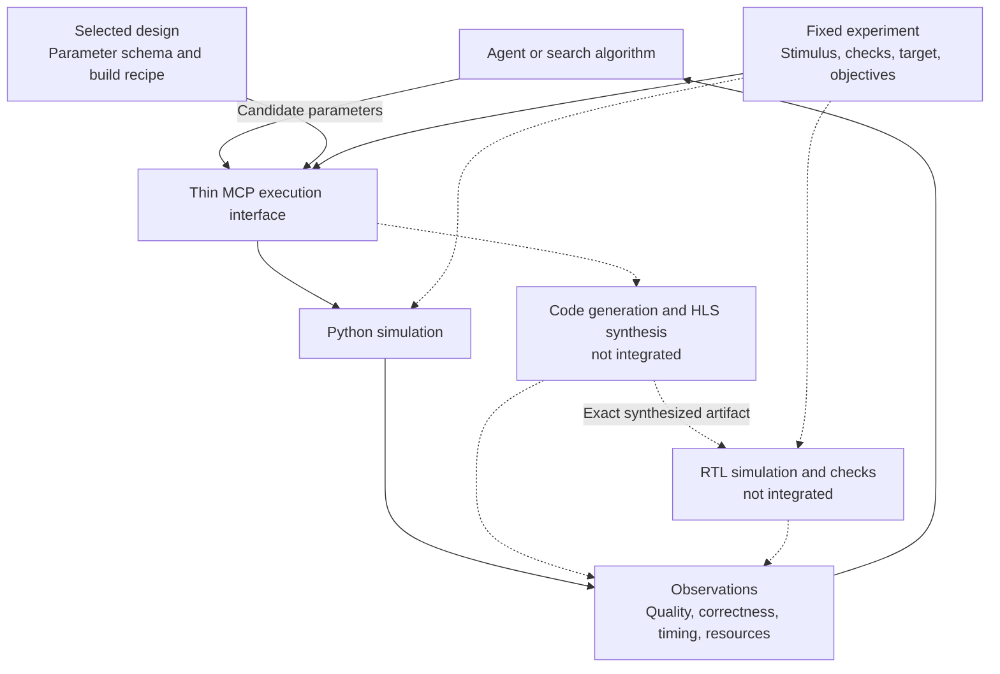

# Problem-agnostic Waveflow execution surface

**Direction reset, 2026-10-04.** The professor's diagram, supplied by Ashesh, defines the intended loop: discover design parameters, simulate, synthesize, verify RTL and compare performance. FIR illustrates the loop; it must not define the interface.

This document supersedes the FIR-first *architectural direction*, not the historical results. The [initial implementation](execution/README.md) now exposes the four operations through MCP/CLI, with real FIR and MemCopy Python execution. Synthesis/RTL contracts are exposed but live execution is not integrated. The original [plan](../../plans/mcp_fir.md) and six-tool pilot remain historical references.

## Boundary

| Owner | Responsibility |
|---|---|
| Design package | Model construction, legal parameter domains, build recipe, testbench and metric definitions |
| Experiment | Fixed workload, reference/checks, device/clock, objective and constraints, execution limits |
| Waveflow execution | Validate, run canonical stages, retain artifacts and report observations |
| Agent or search algorithm | Choose candidates and evaluations; compare results; recommend a design |
| MCP / CLI / Pi connector | Transport requests and observations; no domain calculations or search policy |

Problem-agnostic means **the same operations and result envelope across registered designs**, not an automatic testbench or evaluator for arbitrary Python. Design-specific knowledge remains necessary, but below the interface. Objectives and scoring live with the experiment, not the generic execution service.

## Minimal tool surface

A host binds the server to a registered design and fixed experiment at startup. The signatures are implemented; the synthesis/RTL outputs below remain the target contract. Current `synth` returns unavailable; `rtlsim` rejects IDs without successful synthesis evidence.

| Operation | Input | Output |
|---|---|---|
| `get_param_list()` | Bound experiment | Names, descriptions, types, defaults, domains and coupling constraints; fixed test conditions, metric definitions, available stages and known cost estimates |
| `pysim(params)` | Candidate parameters | Functional/quality metrics, checks, modeled timing if supported, execution duration, result reference |
| `synth(params)` | Candidate parameters | Generated/synthesized artifact reference, HLS resource/timing estimates, execution duration, result reference |
| `rtlsim(synthesis_id)` | Exact successful synthesis artifact | Verification outcome, observed latency/throughput, execution duration, trace/report references |

Use `get_run(run_id)` as supporting retrieval if runs outlive a tool call; it is not another hardware operation. Start with bounded synchronous calls where practical. Do not build a separate orchestration framework merely to wrap existing stages.

Code generation is a synthesis dependency, not necessarily a separate agent tool. Resource prediction is an optional capability, not a prerequisite for every design. DSE is repeated use of these operations, not a mandatory `optimize()` tool. Architecture/source editing belongs to a separate authoring scope.

The agent cannot change the test conditions or relax constraints through candidate parameters. Unknown fields and invalid combinations fail explicitly. Missing stages return unavailable, never fabricated measurements. Capability discovery includes unavailable stages and their reasons.

## What “time” means

| Quantity | Meaning | Comparison rule |
|---|---|---|
| Execution wall time | Seconds spent generating, compiling, synthesizing or simulating | Record phase, machine/toolchain, cache state and workload; repeated fresh attempts for runtime studies |
| Modeled design time | Python-model latency/cycles or simulated duration, if the model supports it | Declare clock, event boundaries, warmup and workload |
| RTL design time | Observed cycles, latency and throughput under the testbench | Compare with Python only for matched events, workload and units |
| HLS timing estimate | Scheduled latency/II and estimated clock period | Keep separate from RTL observations and physical timing closure |

A Python simulation taking less wall time does not mean its hardware design is faster. A requested clock is not achieved timing. HLS resources are estimates, not post-route utilization. Successful RTL execution is not functional verification unless declared checks actually ran and passed.

Each observation carries status, parameters, source/test/target/toolchain identities, metric definitions and units, evidence kind, timing and artifact references. Retain the original evaluation duration separately from cache-retrieval duration. Repeated timing attempts share a request identity but have distinct attempt identities; caching must not erase their measurements. Preserve discrepancies rather than replacing Python results with RTL results.

## Reuse the repository

| Existing primitive | Role and limit |
|---|---|
| [`HwParam`](../../waveflow/hw/hw_module.py) | Discover build-time parameter bindings; legal domains and descriptions still require design metadata. Separate runtime/test configuration. |
| [`BuildDag`, `BuildConfig`, `BuildResult`](../../waveflow/build/build.py) | Execute existing dependencies and retain per-stage `elapsed_seconds`; wrap rather than duplicate. |
| [`SweepRunner`, `Stage`](../../waveflow/build/sweep.py) | Deterministic sweep baseline and per-point failures. Parameter changes require deliberate rebuild policy; timestamp freshness alone is insufficient. |
| [`RtlSimStep`, `ExtractBurstsStep`](../../waveflow/build/trace_steps.py) | RTL execution and timing extraction where integrated. `RtlSimStep` itself asserts no functional correctness. |
| [`fir_block_build.py`](../fir_block/fir_block_build.py) | FIR build recipe. Some task bodies are hand-written; do not claim arbitrary Python automatically becomes RTL. |

Resolve paths and stage choices from trusted registration, not model-supplied shell commands or import paths. Bind synthesized artifacts to source, build parameters, target and toolchain. Bind each evaluation to its test protocol. Isolate or serialize mutable build directories; the shared DAG machinery is not proof of concurrent-run safety.

### Non-FIR acceptance workload

Use [MemCopy](../mem_copy/mem_copy.py), whose [build DAG](../mem_copy/mem_copy_build.py) already connects Python simulation, code generation, synthesis and RTL tracing. Its Python adapter now executes through the same service as FIR, with fixed bytes per job across bus widths. The live hardware paths below remain unintegrated.

Static review found requirements the adapter must resolve:

- Propagate candidate width into scenario generation and trace elaboration, not just the DUT. `_write_scenario_bundles` currently leaves width at its default.
- Bind the RTL runner's relative file list to the returned synthesis artifact; declaring a consumed artifact is insufficient when the runner ignores its value.
- Separate `check_mem_copy_xsi_outputs` correctness/completion checks from its fixed cycle-count assertion. Unknown candidates need measured timing, not a known-answer timing requirement.
- Measure the same completion event: current Python `end_cycles` is simulation end, whereas the RTL checker uses last completion.

## Restructure the existing work

| Current work | Treatment |
|---|---|
| `contracts.py`, `fir_metrics.py`, FIR ranking in `service.py` | Keep as FIR workload/experiment policy; remove these assumptions from the future shared service. |
| `dse_store.py`, result/provenance conventions | Reuse useful behavior, revising identity for artifacts, test protocols and repeated attempts. Do not hold a short SQLite transaction across a vendor-tool job. |
| `backends.py`, committed replay corpus | Retain as labeled offline regression support. Replay is not the execution implementation or runtime benchmark. |
| MCP, CLI and Pi adapters | Adapt to the common execution contract after it works without an agent. |
| FIR benchmark and recovery tests | Preserve historical evidence. Defer additional harness-policy optimization until shared execution is established. |

## Acceptance sequence

1. **Contract:** review the four operations against the professor's loop; keep fixed tests distinct from editable design parameters.
2. **Cross-design execution:** expose FIR and MemCopy through the same schemas/service, using their existing build recipes and resolving the gaps above. No FIR fields or ranking in the shared layer. Parameter changes must affect the actual instantiated design.
3. **Synthesis-to-RTL continuity:** on a provisioned toolchain machine, produce RTL, consume that exact artifact, execute declared correctness checks and report measured timing. Local replay tests cannot close this gate.
4. **Timing study:** compare matched Python/RTL events and separately measure execution costs; retain failed and unsupported points.
5. **DSE:** run deterministic search, then Pi-driven search against the same fixed experiments and budgets. Score feasible design quality and cost; harness ablations are secondary.

Repository-wide placement remains a follow-up decision: the working constraint permits new code only under `examples/dse_fir/`, so the initial shared surface lives in `execution/`. CPU cross-design execution is demonstrated; live hardware validation, general arbitrary-design support and optimization performance are not.
