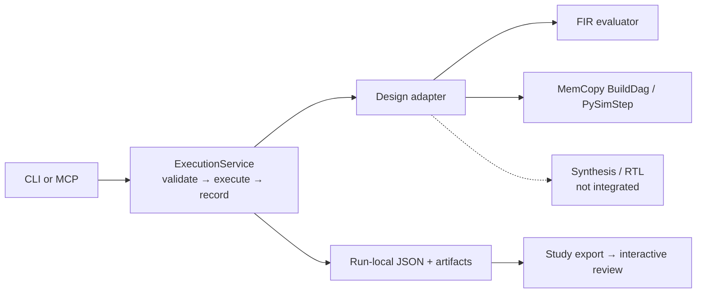

# Run the execution demo

Use one interface to try parameters on FIR and MemCopy. The caller chooses the
parameters; each design supplies its model, legal values and checks.



Python execution works. Synthesis and RTL adapters are not implemented yet; no RTL
correctness, measured hardware resources or physical timing is claimed.

## Try it

From the repository root:

```sh
uv sync --extra dev
uv run python -m examples.dse_fir.execution.demo --output ./execution-demo
```

Open `execution-demo/review.html`. The demo tries two settings per design and repeats
one setting. It also records invalid requests and unavailable synthesis: 14 attempts
in total. The page lets you inspect runs and save review notes; it does not execute tools.

Use a new output directory each time. Keep that directory to retain the raw files
referenced by `study.json`. If you delete `.venv`, rerun `uv sync --extra dev`.

To browse without running anything, download the [recorded review](review.html).
The [study JSON](../evidence/execution_study.json) contains the recorded observations.
The offline viewer includes a clickable architecture, fixed conditions and candidate
parameters, attempt filters, metrics, checks and timing. Import `study.json` or
export/reimport notes to continue a review. GitHub does not render these HTML files inline.

For a short explanation, open the [presentation](presentation.html): four sections,
diagrams and results, with presentation mode, speaker notes and a separate appendix.

## What this establishes

FIR evaluates fixed-point quality across tap counts. MemCopy checks copied data at
32- and 64-bit bus widths under a fixed byte workload. Repeated calls keep the same
request identity but create new attempts; invalid and unavailable outcomes remain visible.
CLI and actual stdio MCP are tested with both designs.

**This is a scripted functional demo, not an agent-harness benchmark.** No agent
selected these candidates, and no equal-budget search comparison has been run on
this four-tool interface. Earlier model trials used the legacy six-tool FIR service.
Model cycles are not hardware measurements; host wall times include cold imports
and do not establish speedup.

## Code map

| File | Responsibility |
|---|---|
| `designs.py` | Parameter schemas, fixed conditions, source identity and design execution |
| `service.py` | Validation, fresh attempt directories, saved outcomes and tool registration |
| `__main__.py` | JSON CLI and stdio MCP |
| `demo.py` | Fixed demonstration and study export—not an optimizer |
| `visualizer.html` | Offline evidence viewer and review-note import/export |

## Run a single design

```sh
uv run python -m examples.dse_fir.execution --design mem_copy --root ./mem-study describe
uv run python -m examples.dse_fir.execution --design mem_copy --root ./mem-study call pysim --args '{"params":{"mem_dwidth":32}}'
uv run python -m examples.dse_fir.execution --design mem_copy --root ./mem-study results
uv run python -m examples.dse_fir.execution --design mem_copy --root ./mem-study serve
```

Use the last command in your MCP host. It exposes `get_param_list`, `pysim`, `synth`
and `rtlsim`; the [contract](../EXECUTION_SURFACE.md) explains their inputs and results.
Do not substitute the legacy `dse` profile; it and the Pi adapter expose the older six tools.

Set fixed test conditions with `--conditions` JSON when creating a study; repeat
them when reopening it. Changed source, dependencies or conditions require a new
root. Use one caller at a time; interrupted runs can remain marked `running`.
The service is not a concurrent scheduler, sandbox or crash-recovery system.

To add a design, register an adapter with `describe`, `validate`, `pysim` and source
identity, then exercise a real workload through the unchanged CLI/MCP service.
New code stays under `examples/dse_fir/`; shared-package placement is a later decision.

## Test or extend it

```sh
uv run pytest examples/dse_fir/tests -m 'not vitis and not xsi'
uv run --no-project --with playwright python examples/dse_fir/tests/test_execution_visualizer.py
```

Browser tests need Chrome; set `WAVEFLOW_TEST_CHROME` to override its location.
They cover import rejection, filters, review export/reimport, safe text rendering and
responsive layouts. No vendor tools or model calls are needed.

The branch includes upstream `c10da30` and uses MCP SDK 2.x.
See the [test results](../VERIFICATION.md) for known upstream failures, or the
[hardware handoff](HANDOFF.md) to continue implementation.
