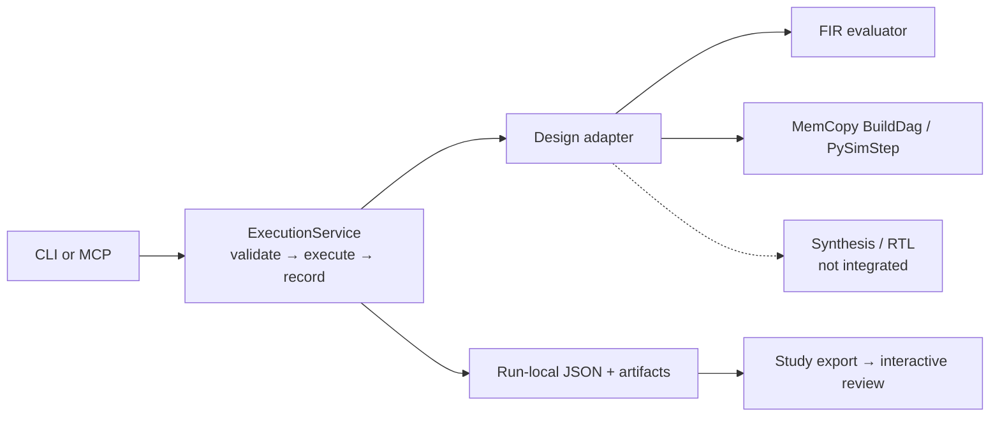

# Shared execution demo

**Objective:** use the same tools to explore different Waveflow designs. Fixed tests stay separate from candidate parameters; search policy stays outside the service.

## Run and inspect

```sh
uv sync --extra dev
uv run python -m examples.dse_fir.execution.demo --output ./execution-demo
```

Open `execution-demo/review.html`. It contains real FIR and MemCopy observations, a clickable architecture, parameter/condition inspection, timing, checks, and review-note export. Import `study.json` or a saved review to continue discussion. The page is offline; its controls do not execute hardware.

A [recorded review](review.html) and its [study JSON](../evidence/execution_study.json)
are included for immediate discussion. Download the HTML to open it; GitHub does
not render HTML files inline. This snapshot is a functional demonstration, not
a controlled runtime comparison. Raw run-local files are produced by the command above.

The demo runs two parameter points and one repeated point per design. Invalid parameters and reuse of unavailable synthesis are deliberate negative controls. Use a new output directory for every run; existing evidence is never overwritten. Clearing `.venv` is fine: rerun `uv sync --extra dev`.

## Code map



| File | Responsibility |
|---|---|
| `designs.py` | Registered design schemas, fixed conditions, source identity and real Python evaluation |
| `service.py` | Request validation, fresh attempt directories, durable outcomes and four-tool registration |
| `__main__.py` | Thin JSON CLI / stdio MCP |
| `demo.py` | Fixed cross-design demonstration and evidence export; not an optimizer |
| `visualizer.html` | Offline study viewer and review-note roundtrip |

## Direct use

```sh
uv run python -m examples.dse_fir.execution --design mem_copy --root ./mem-study describe
uv run python -m examples.dse_fir.execution --design mem_copy --root ./mem-study call pysim --args '{"params":{"mem_dwidth":32}}'
uv run python -m examples.dse_fir.execution --design mem_copy --root ./mem-study results
uv run python -m examples.dse_fir.execution --design mem_copy --root ./mem-study serve
```

MCP exposes exactly `get_param_list`, `pysim`, `synth`, `rtlsim`. Configure the host to run the same `serve` command; do not substitute the legacy `dse` profile. Host-only `--conditions` accepts JSON; repeat identical conditions when reopening a root. The old Pi adapter still targets the legacy six-tool FIR surface, not this interface.

## What is demonstrated

- FIR: real fixed-point quality at different tap counts.
- MemCopy: real Python memory-copy checks at 32/64-bit widths, with fixed byte workload. Model `end_cycles` is simulation end, not last-completion latency.
- Identical requests produce distinct attempts with the same request identity. No cache hides timing repetitions.
- Invalid and unavailable outcomes are retained, not silently dropped.
- CLI and actual stdio MCP exercise both designs in the tests.

## Limits and extension

`synth` returns `unavailable`: the live adapter is not integrated. `rtlsim` requires a successful bound synthesis ID; none is produced by this slice. No replay substitution, RTL correctness, measured hardware resources or physical timing is claimed. Wall time includes cold imports and validation; these few attempts do not establish speedup.

Use one serial caller per experiment root. This is not a concurrent job scheduler, sandbox or crash-recovery service; interrupted attempts may remain `running`. Source/dependency or condition changes require a new root. The standalone study carries provenance and artifact references; keep the output directory to retain the actual referenced files.

To extend: add a registered adapter with `describe`, `validate`, `pysim` and source identity; test a real new workload through the unchanged service/transport. Live synthesis needs artifact binding, isolated workspaces and reusable correctness checks before enabling the capability. Shared-package placement is deferred; code stays within the existing `examples/dse_fir/` working boundary.

## Verify

```sh
uv run pytest examples/dse_fir/tests -m 'not vitis and not xsi'
uv run --no-project --with playwright python examples/dse_fir/tests/test_execution_visualizer.py
```

Browser checks require Chrome (`WAVEFLOW_TEST_CHROME` may select its executable). They cover import rejection, filters, review export/reimport, safe text rendering and responsive layouts. No vendor tools or model calls are needed.
